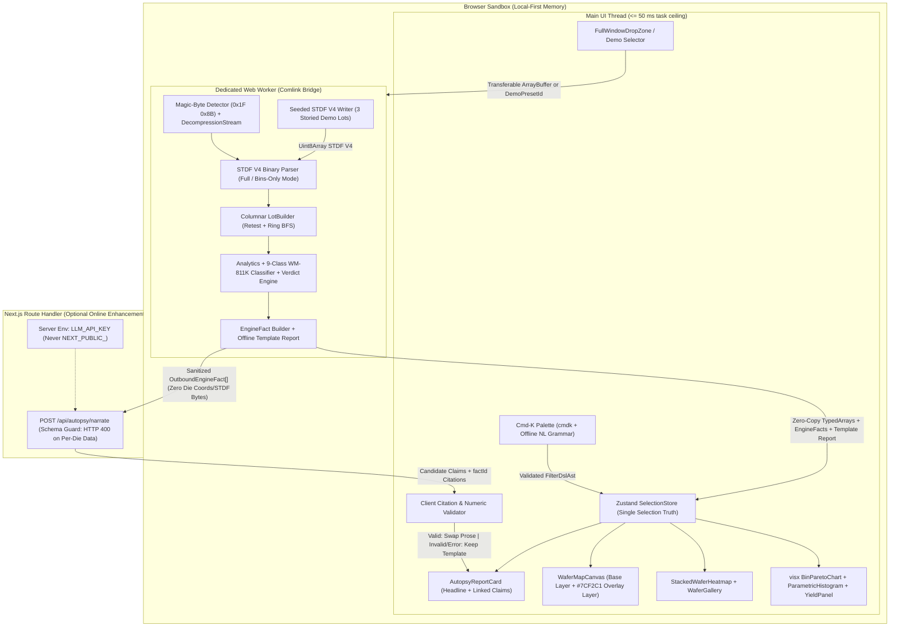
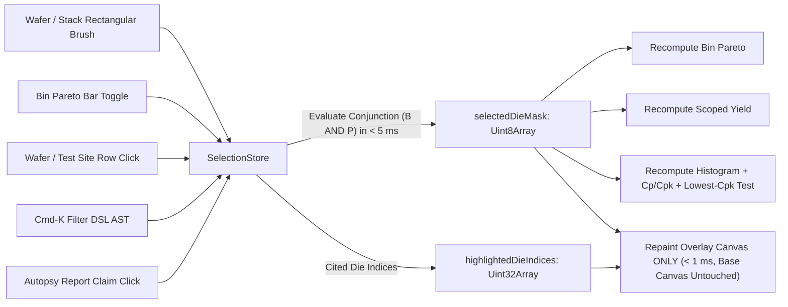
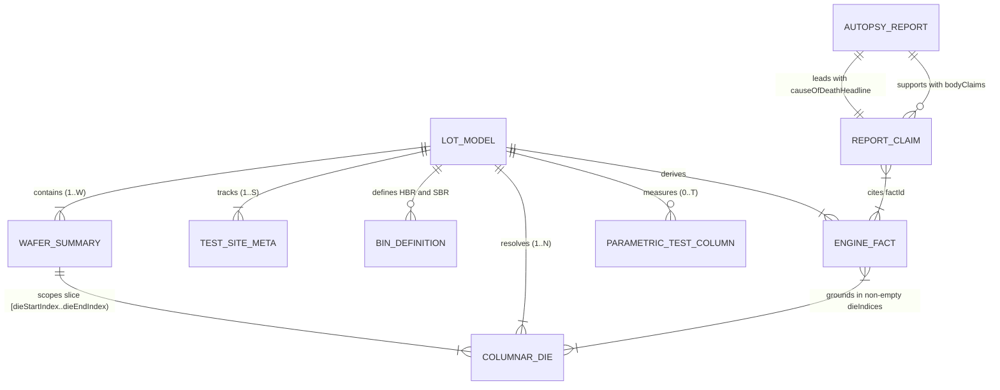

# Design Document: Chip Autopsy Lab

## Overview

Chip Autopsy Lab is a local-first, browser-based semiconductor failure analysis workbench built for Kiroween 2026 (Frankenstein category). It stitches four distinct technical eras and paradigms into one cohesive diagnostic instrument:

1. **1990s binary ATE telemetry (`STDF V4`)**: A zero-dependency TypeScript tag-length-value (`REC_LEN`, `REC_TYP`, `REC_SUB`) binary reader and synthetic writer running off the main thread in a dedicated Web Worker, supporting native `DecompressionStream('gzip')` decompression, big/little-endian framing, multi-site `PIR`/`PTR`/`PRR` interleaving, `PTR` default inheritance, and deterministic retest resolution.
2. **Spatial defect signature taxonomy (`WM-811K` 9 classes)**: A weightless, $D_4$-invariant, deterministic spatial feature classifier scoring wafers and multi-wafer stacks across `Center`, `Donut`, `Edge-Loc`, `Edge-Ring`, `Loc`, `Near-full`, `Random`, `Scratch`, and `None`, paired with hedged fab and test-floor root-cause hypotheses.
3. **Verdict-first Autopsy Report with Core LLM Narration and Citation Guardrails**: A deterministic Engine Fact and template report pipeline that renders an immediate offline diagnosis (`Cause of death: ...`) where every claim links directly to resolved Die IDs, Bin Pareto bars, and parametric tests, progressively enhanced by a Core Next.js server-side LLM narrator (`POST /api/autopsy/narrate`) guarded by outbound privacy stripping and strict client-side `factId`, Die ID, and numeric rounding validation.
4. **Keynote-grade interactive graphics (`Canvas2D` + `visx` + `cmdk`)**: A two-layer device-pixel-ratio-scaled `Canvas2D` wafer map (base geometry/fills + zero-base-repaint `#7CF2C1` selection/evidence overlay), `visx` Pareto and parametric capability charts, sub-100 ms cross-chart spatial brushing over columnar typed arrays, and a `0 ms` `Cmd-K` / `Ctrl-K` natural-language Filter DSL palette.

### Locked Architectural Principles

- **Raw STDF never leaves the browser**: Binary logs, per-die coordinates, and per-die measurement arrays stay strictly in client memory (`ArrayBuffer` / typed arrays). Only stripped aggregate `EngineFact` summaries (or Stretch `Cmd-K` catalog schemas) ever cross `/api/autopsy/narrate`.
- **Framework-free deterministic core**: All binary parsing/writing, columnar modeling, yield/Pareto/stacking/capability math, WM-811K classification, verdict selection, citation validation, Filter DSL evaluation, and synthetic demo generation live in `src/core/` with zero React, Next.js, or DOM imports so every invariant runs directly in Node under Vitest + `fast-check`.
- **Single selection source of truth**: One Zustand `SelectionStore` drives wafer spatial brushing, Bin Pareto bar toggles, Wafer/Site scoping, `Cmd-K` Filter DSL predicates, and Autopsy Report claim highlights via typed `Uint8Array` bitmasks.

### Resolved Open Design Decisions

| Item | Decision | Rationale & Verification |
|---|---|---|
| **Final Pass-Die Colour & Contrast** | **`#53655D`** (`LCH(41.2, 8.3, 165.4)`) | Preserves the exact chroma (`8.3`) and muted grey-green hue (`165.4°`) of the steering starting point `#3A4A43` (`2.11:1` on `#0A0A0B`), lifted along `L*` (`29.9 -> 41.2`) to achieve **`3.19:1`** WCAG 2.2 luminance contrast on `#0A0A0B` (`bg`), **`3.04:1`** on `#111113` (`panel`), and **`4.53:1`** against `#7CF2C1` (`accent` outlines). Because `#FF7A1A` on `#0A0A0B` has contrast `7.59:1 < 9.0` ($3 \times 3$), CIE luminance algebra ($\text{CR}(P, \text{bg}) \cdot \text{CR}(\text{fail}, P) = 7.59$) forbids any intermediate flat sRGB fill from simultaneously exceeding `3:1` against both `#0A0A0B` and `#FF7A1A` (`#FF7A1A` vs `#53655D` is `2.38:1`). To guarantee WCAG 2.2 SC 1.4.1 and 1.4.11 non-color differentiation, every die renders inside a `1 px` `#0A0A0B` street border (`7.59:1` fail-to-street, `3.19:1` pass-to-street) and failing dies add a crisp `#0A0A0B` inner center micro-dot when zoomed (`diePitchPx >= 7`). |
| **Secondary Fail-Bin LCH Palette** | Equal-lightness `L* = 66.0` (`~7.6:1` on `#0A0A0B`): `#00ACEA`, `#AE90F3`, `#FD7584`, `#B99F35`, `#00B0C8`, `#E87AC7`, `#61A1FF` | Rank-1 dominant yield-loss failing bin always takes `#FF7A1A` (`L* = 66.0, C* = 82.6, H = 56.1°`). Ranks 2+ cycle deterministically through equal-lightness LCH hues (`250°, 305°, 18°, 92°, 218°, 338°, 278°`), excluding `[125°, 200°]` (preserving `#7CF2C1` at `163.2°`) and `[40°, 72°]` (preserving `#FF7A1A` at `56.1°`). |
| **Verdict Precedence Rule** | Deterministic 5-tier hierarchy (Section 3.5) | Resolves conflicts between multi-wafer spatial signatures, test-site hardware anomalies, and single-wafer excursions: (0) Zero-failure lot -> `No failure pattern detected`; (1) Test-site anomaly (`z >= 3.0`, `> 5.0 pp` drop) wins when spatial pattern is `Random`/`None` OR when the anomalous site accounts for `>= 50%` of excess Lot failures; (2) Structured primary WM-811K spatial class (`Center`, `Donut`, `Edge-Loc`, `Edge-Ring`, `Loc`, `Near-full`, `Scratch`); (3) Diluted single-wafer structured excursion (`confidence >= 0.70`, `>= 25%` of Lot fails); (4) `Random defect failure`; (5) `Baseline low-density loss` (`None` with `>= 1` fail). |
| **9-Class WM-811K Classifier & Thresholds** | $D_4$-invariant radial, angular-resultant, clustering, and bridged-PCA feature scorer (Section 3.4) | Locks `MIN_FAIL_FRACTION = 0.015` (`1.5%`), `MIN_FAIL_COUNT = 5`, `MIN_CLASS_CONFIDENCE = 0.45`, and `STACK_CELL_MIN_FAIL_RATE = 0.20` (with `failCount >= min(2, waferCount)`). All spatial features are exact invariants of the dihedral group $D_4$ ($90^\circ/180^\circ/270^\circ$ rotations and X/Y reflections), guaranteeing `0.00` rotation/mirror drift (strictly within Property 8's `±0.05` budget). |
| **LLM Narrator Scope (Owner Override)** | **Core MVP** (`Requirements 10.6, 10.7, 16.3`; `Properties 11, 14`) | Promoted from Stretch to Core MVP. Deterministic template Autopsy Report renders immediately upon parse completion (`0 ms` network wait); when `LLM_API_KEY` is configured on `POST /api/autopsy/narrate`, stripped aggregate `EngineFact`s are narrated asynchronously and swapped in only if every claim passes `factId`, Die ID, and numeric rounding validation; any failure or missing key retains the deterministic template seamlessly. (`Cmd-K` LLM translation `12.3` and URL state `Req 13` remain Stretch.) |
| **Synthetic Demo Generator** | 3 seeded storied STDF V4 lots (`25` wafers x `633` dies each) | Exercises all three primary diagnostic paths offline in `< 3 s`: (1) `edge-ring-etch` (plasma etch non-uniformity -> `Edge-Ring`), (2) `handling-scratch` (robotic transfer blade contact -> `Scratch`), and (3) `site2-probe-contact` (quad-site `HEAD 1 / SITE 2` oxidized probe needles -> spatial `Random` overridden by `Test Site 1:2 concentration anomaly`). |

---

## Architecture

### Confirmed Repository Layout

Confirming and refining `.kiro/steering/structure.md` for Next.js App Router + strict `src/core/` isolation:

```text
.
├── .kiro/
│   ├── settings/mcp.json
│   ├── steering/{product,tech,structure,design-language}.md
│   └── specs/chip-autopsy-lab/{requirements,design,tasks}.md
├── src/
│   ├── app/
│   │   ├── layout.tsx                        # Self-hosted Inter + Geist Mono, dark theme root
│   │   ├── page.tsx                          # Client analysis workbench entry
│   │   ├── globals.css                       # Tailwind v4 @theme CSS variables
│   │   └── api/
│   │       └── autopsy/
│   │           └── narrate/
│   │               └── route.ts              # SOLE server code: LLM narrator + Stretch Cmd-K proxy
│   ├── core/                                 # Zero React / Next.js / DOM imports
│   │   ├── stdf/
│   │   │   ├── types.ts                      # STDF V4 record & field schemas (shared reader/writer)
│   │   │   ├── binary-cursor.ts              # Bounds-checked endian DataView reader/writer
│   │   │   ├── gzip.ts                       # Magic-byte 0x1F 0x8B detector & DecompressionStream cap
│   │   │   ├── stdf-parser.ts                # Streaming/buffer STDF V4 decoder + PTR defaults + PIR map
│   │   │   ├── stdf-writer.ts                # Deterministic STDF V4 binary serializer
│   │   │   ├── stdf-roundtrip.prop.test.ts   # Property 1
│   │   │   └── stdf-parser-safety.prop.test.ts # Property 2
│   │   ├── model/
│   │   │   ├── types.ts                      # Columnar LotModel, WaferModel, DieId, SiteKey
│   │   │   ├── lot-builder.ts                # Retest resolution, HBIN_PF fallback, 4-step ring BFS
│   │   │   └── retest-resolver.prop.test.ts  # Property 3
│   │   ├── analytics/
│   │   │   ├── yield-summary.ts              # Lot/Wafer/Site first-pass & final yield, site z-test
│   │   │   ├── yield-summary.prop.test.ts    # Property 4
│   │   │   ├── bin-pareto.ts                 # HBIN/SBIN Pareto + cumulative share
│   │   │   ├── bin-pareto.prop.test.ts       # Property 5
│   │   │   ├── stacked-heatmap.ts            # Multi-wafer (X,Y) fail density & dominant bin
│   │   │   ├── stacked-heatmap.prop.test.ts  # Property 6
│   │   │   ├── parametric-stats.ts           # Welford mean/sigma, Cp/Cpk, histogram bins, SI units
│   │   │   └── parametric-stats.prop.test.ts # Property 7
│   │   ├── patterns/
│   │   │   ├── wm811k-classifier.ts          # 9-class deterministic spatial feature scorer
│   │   │   ├── root-causes.ts                # Hedged physical & test-hardware hypotheses
│   │   │   └── wm811k-classifier.prop.test.ts # Property 8
│   │   ├── report/
│   │   │   ├── engine-facts.ts               # Structured EngineFact extractor
│   │   │   ├── verdict-precedence.ts         # 5-tier primary cause-of-death selector
│   │   │   ├── template-report.ts            # Offline deterministic Autopsy Report generator
│   │   │   ├── citation-validator.ts         # Outbound privacy sanitizer + LLM claim/numeric validator
│   │   │   ├── autopsy-report.prop.test.ts   # Property 10
│   │   │   ├── citation-validator.prop.test.ts # Property 11 (Core)
│   │   │   └── llm-payload-privacy.prop.test.ts # Property 14 (Core)
│   │   ├── query/
│   │   │   ├── filter-dsl.ts                 # Filter DSL AST, evaluator, chip formatter, serializer
│   │   │   ├── nl-grammar.ts                 # Deterministic offline Cmd-K query parser
│   │   │   ├── url-state-codec.ts            # Stretch Req 13 URL search-param codec
│   │   │   ├── selection-predicates.prop.test.ts # Property 12
│   │   │   └── filter-dsl-codec.prop.test.ts # Property 13
│   │   └── demo/
│   │       ├── prng.ts                       # Seeded Mulberry32 + Box-Muller normal sampler
│   │       ├── demo-generator.ts             # 3 storied 25-wafer STDF V4 lot generators
│   │       └── demo-generator.prop.test.ts   # Property 9
│   ├── workers/
│   │   ├── autopsy.worker.ts                 # Module Web Worker entrypoint exposed via Comlink
│   │   └── worker-client.ts                  # Typed main-thread Comlink wrapper + transferable handoff
│   └── ui/
│       ├── state/selection-store.ts          # Single Zustand store + derived Uint8Array die masks
│       ├── wafer-map/                        # BaseCanvas, OverlayCanvas, WaferLegend, StackedGallery
│       ├── charts/                           # BinParetoChart, ParametricHistogram, CapabilityTable, YieldPanel
│       ├── report/                           # AutopsyReportCard, ClaimInlineButton, NarrationBadge
│       ├── command-palette/                  # CommandPalette (cmdk), FilterChipBar
│       ├── layout/                           # AppShell, FullWindowDropZone, EmptyStateCard
│       └── tokens/                           # palette.ts (#53655D, #FF7A1A, #7CF2C1, LCH bins, magma LUT)
├── tests/fixtures/                           # Golden big/little-endian & malformed STDF byte fixtures
└── e2e/                                      # Playwright e2e, offline, a11y, and perf-gate specs
```

### System Architecture & Trust Boundaries



### File Ingest, Probe-Sweep Reveal, and Core LLM Narration Sequence

```mermaid
sequenceDiagram
    actor User
    participant UI as Main Thread UI
    participant Worker as Autopsy Web Worker
    participant API as POST /api/autopsy/narrate

    User->>UI: Drop .stdf/.stdf.gz or Click "Load demo lot"
    UI->>Worker: loadFile(transfer(arrayBuffer)) or loadDemo(presetId)
    Worker->>Worker: Check 0x1F 0x8B magic bytes & stream gzip if compressed
    alt Uncompressed size > 200 MB and mode unset
        Worker-->>UI: Pause & return LargeFilePrompt(bytesSeen)
        UI-->>User: Prompt "Bins-Only Mode (Recommended)" vs "Full Mode"
        User->>UI: Select parse mode
        UI->>Worker: resumeParse(mode)
    end
    loop Every 64 KB / 4,096 records
        Worker-->>UI: onProgress(bytes, records, resolvedDies, sweepBatchCoords)
        UI->>UI: Concurrent <= 3 s skippable probe-sweep on Base/Overlay Canvas
    end
    Worker->>Worker: Resolve retests, Ring BFS, Yield/Pareto/Stack/Cp/Cpk, WM-811K, EngineFacts
    Worker-->>UI: Transfer LotColumnarTransfer + EngineFacts + TemplateAutopsyReport
    UI->>UI: Render Cause-of-Death Headline & Linked Charts Immediately (<= 3 s demo budget)
    par Progressive Core LLM Narration (Non-Blocking)
        UI->>UI: sanitizeOutboundNarratePayload(facts) (strip dieIds)
        UI->>API: POST { lotSummary, verdict, outboundFacts } (4 s timeout)
        alt LLM_API_KEY configured & upstream succeeds
            API-->>UI: { claims: [{ id, text, citedFactIds }] }
            UI->>UI: validateLlmNarration(candidate, facts, lot)
            alt All citations, Die IDs, and rounded numbers match
                UI->>UI: Replace body claims with verified clinical narration
            else Validation fails
                UI->>UI: Discard response; retain deterministic TemplateAutopsyReport
            end
        else 503 No API key / Offline / Timeout / 4xx-5xx
            UI->>UI: Retain deterministic TemplateAutopsyReport silently
        end
    end
```

### Reactive Cross-Filtering & Claim-Click Data Flow



---

## Components and Interfaces

### 3.1 STDF V4 Binary Reader, Writer, and Gzip Guard (`src/core/stdf/`)

Both `stdf-parser.ts` and `stdf-writer.ts` share a single declarative record descriptor table so round-trip property tests (`Property 1`) exercise every binary field codec symmetrically.

```typescript
export type CpuEndianness = 'big' | 'little'; // FAR.CPU_TYPE: 1 = 'big', 2 = 'little', 0 = VAX (unsupported)
export type ParseMode = 'full' | 'bins-only';

export interface StdfRecordHeader {
  readonly recLen: number; // U*2 payload byte length excluding 4-byte header
  readonly recTyp: number; // U*1
  readonly recSub: number; // U*1
  readonly byteOffset: number;
}

export type ParseFatalCode =
  | 'EMPTY_INPUT'
  | 'GZIP_DECOMPRESS_FAILED'
  | 'MISSING_FAR_HEADER'
  | 'UNSUPPORTED_STDF_VERSION'
  | 'UNSUPPORTED_CPU_TYPE_VAX'
  | 'ZERO_VALID_PRR';

export interface ParseFatalError {
  readonly code: ParseFatalCode;
  readonly message: string;
  readonly byteOffset?: number;
}

export type ParseWarningCode =
  | 'TRUNCATED_TAIL_RECORD'
  | 'MALFORMED_RECORD_FIELD'
  | 'ORPHAN_TEST_RECORD'
  | 'UNCLOSED_PIR_AT_WRR'
  | 'MISSING_HBIN_PF_FLAG'
  | 'NON_FINITE_MEASUREMENT';

export interface ParseWarning {
  readonly code: ParseWarningCode;
  readonly byteOffset: number;
  readonly recTyp: number;
  readonly recSub: number;
  readonly detail: string;
}

export interface PtrDefaultContext {
  readonly testNum: number;
  readonly testTxt: string;
  readonly units: string;
  readonly resScal: number; // I*1 power-of-10 display exponent only
  readonly llmScal: number; // I*1
  readonly hlmScal: number; // I*1
  readonly loLimit: number | null; // Base units; null when OPT_FLAG bit 4 or bit 6 is set
  readonly hiLimit: number | null; // Base units; null when OPT_FLAG bit 5 or bit 7 is set
}

export interface ParseProgress {
  readonly bytesProcessed: number;
  readonly totalBytes: number | null;
  readonly recordsDecoded: number;
  readonly diesResolved: number;
  /** Newly decoded PRR coordinates for the <= 3 s concurrent probe-sweep reveal */
  readonly sweepBatch?: Int16Array; // interleaved [x0, y0, passFlag0, ...]
}

export interface ParseOptions {
  readonly mode: ParseMode;
  readonly maxUncompressedBytes?: number; // Default 200 * 1024 * 1024 (200 MB)
  readonly onProgress?: (progress: ParseProgress) => void;
}

export type Result<T, E> =
  | { readonly ok: true; readonly value: T }
  | { readonly ok: false; readonly error: E };

export function hasGzipMagicBytes(header: Uint8Array): boolean;

export function decompressGzipStreamWithCeiling(
  input: Uint8Array,
  ceilingBytes: number,
): Promise<
  | { readonly kind: 'ok'; readonly bytes: Uint8Array }
  | { readonly kind: 'ceiling_exceeded'; readonly bytesObserved: number }
  | { readonly kind: 'error'; readonly error: ParseFatalError }
>;

export function parseStdfBytes(
  rawOrDecompressed: Uint8Array,
  options: ParseOptions,
): Result<ParsedLotBuildInput, ParseFatalError>;

export function writeStdfBytes(spec: StdfWriteLotSpec): Uint8Array;
```

**Key STDF V4 Decoding Rules Enforced in `stdf-parser.ts`:**
- **Bounds-first cursor**: `BinaryCursor` validates `offset + byteCount <= recordEnd <= buffer.byteLength` before every primitive or variable-length (`C*n`, `B*n`, `D*n`, `kxTYPE`) read. If a record stops cleanly at `recordEnd` before optional trailing specification fields, remaining fields resolve to `undefined` without warning (Req 1.7). If a variable-length prefix overflows `recordEnd`, the parser emits `MALFORMED_RECORD_FIELD` and advances to `recordEnd` (Req 2.3).
- **`PTR` Inheritance & `OPT_FLAG`**: The first `PTR` observed for each `TEST_NUM` populates `Map<number, PtrDefaultContext>`. Subsequent `PTR` records for that `TEST_NUM` inherit `UNITS`, `RES_SCAL`, `LLM_SCAL`, `HLM_SCAL`, `LO_LIMIT`, and `HI_LIMIT` whenever omitted at `recordEnd` or flagged as default via `OPT_FLAG`. Bits `4` (`0x10`) and `6` (`0x40`) force `loLimit = null`; bits `5` (`0x20`) and `7` (`0x80`) force `hiLimit = null`. `RESULT`, `LO_LIMIT`, and `HI_LIMIT` remain strictly in base units (Req 1.8).
- **Multi-site open-part state machine**: `PIR` opens a part context in `openParts: Map<number, OpenPartMeasurements>` keyed by `siteKey = ((headNum & 0xff) << 8) | (siteNum & 0xff)`. Interleaved `PTR`, `MPR`, and `FTR` records attach to `openParts.get(siteKey)`. `PRR` closes `siteKey` and emits a chronological `RawPartExecution` (Req 1.9).

---

### 3.2 Columnar Lot, Wafer, and Die Model (`src/core/model/`)

To sustain `<= 100 ms` interactive brushing across `250,000` dies (`25` wafers x `10,000` dies, Req 15.5) while keeping `200 MB` STDF logs comfortably inside browser memory, resolved dies and parametric measurements are stored in flat, transferable typed arrays rather than millions of boxed JavaScript objects.

```typescript
export type DieId = string; // "<waferId>:<x>,<y>" or "<waferId>:part-<seq>" when coord === -32768
export type BinMode = 'SBIN' | 'HBIN';
export const STDF_MISSING_COORD = -32768;

export interface BinDefinition {
  readonly code: number;
  readonly name: string;
  readonly passFail: 'P' | 'F' | 'U';
}

export interface TestSiteMeta {
  readonly siteIndex: number; // Dense 0..S-1 index stored in die.siteIndex
  readonly headNum: number;
  readonly siteNum: number;
  readonly label: string; // e.g., "1:2"
}

export interface WaferGeometry {
  readonly wfSize?: number;
  readonly dieHt?: number;
  readonly dieWid?: number;
  readonly wfUnits?: number;
  readonly wfFlat: 'U' | 'D' | 'L' | 'R' | ' ';
  readonly centerX?: number;
  readonly centerY?: number;
  readonly posX: 'L' | 'R'; // Default 'R'
  readonly posY: 'U' | 'D'; // Default 'U'
}

export interface WaferSummaryMeta {
  readonly waferIndex: number;
  readonly waferId: string; // Sanitized plain text from WIR.WAFER_ID or fallback "W01"
  readonly dieStartIndex: number;
  readonly dieEndIndex: number; // Exclusive
  readonly minX: number;
  readonly maxX: number;
  readonly minY: number;
  readonly maxY: number;
  readonly maxRingIndex: number;
  readonly geometry: WaferGeometry;
}

export interface ParametricTestColumn {
  readonly testNum: number;
  readonly testName: string;
  readonly units: string;
  readonly resScal: number;
  readonly llmScal: number;
  readonly hlmScal: number;
  readonly loLimit: number | null;
  readonly hiLimit: number | null;
  /** Length === lot.dieCount; NaN indicates die did not execute this test */
  readonly values: Float32Array;
}

export interface ColumnarDies {
  readonly count: number;
  readonly waferIndex: Uint16Array;
  readonly x: Int16Array;
  readonly y: Int16Array;
  readonly hasValidCoords: Uint8Array; // 1 when x !== -32768 && y !== -32768, else 0
  readonly siteIndex: Uint8Array;      // Dense index into LotModel.sites
  readonly firstPass: Uint8Array;      // 1 = passed chronologically first PRR, 0 = failed
  readonly finalPass: Uint8Array;      // 1 = passed chronologically last PRR, 0 = failed
  readonly hbin: Uint16Array;          // Final PRR HARD_BIN
  readonly sbin: Uint16Array;          // Final PRR SOFT_BIN (65535 if omitted)
  readonly retestCount: Uint16Array;   // totalPRRsAtDie - 1
  readonly ringIndex: Uint16Array;     // 4-neighbour steps to outside tested set (0 if no valid coords)
  readonly firstPrrOrder: Uint32Array; // Chronological probe stepping index for probe-sweep
}

export interface LotModel {
  readonly lotId: string;
  readonly partTyp: string;
  readonly jobNam: string;
  readonly parseMode: ParseMode;
  readonly endianness: CpuEndianness;
  readonly wafers: readonly WaferSummaryMeta[];
  readonly sites: readonly TestSiteMeta[];
  readonly hbins: ReadonlyMap<number, BinDefinition>;
  readonly sbins: ReadonlyMap<number, BinDefinition>;
  readonly dies: ColumnarDies;
  readonly dieIds: readonly DieId[]; // Canonical IDs indexed 0..count-1
  readonly dieIndexById: ReadonlyMap<DieId, number>;
  /** Spatial O(1) lookup per wafer: key = ((x + 32768) * 65536) + (y + 32768) */
  readonly waferCoordIndex: readonly ReadonlyMap<number, number>[];
  readonly tests: ReadonlyMap<number, ParametricTestColumn>;
  readonly warnings: readonly ParseWarning[];
}

export function resolvePartPassFail(
  partFlg: number,
  hardBin: number,
  hbins: ReadonlyMap<number, BinDefinition>,
): { readonly passed: boolean; readonly missingHbinFlagWarning: boolean };

export function computeWaferEdgeRingIndices(
  coords: ReadonlyArray<{ readonly x: number; readonly y: number }>,
): Uint16Array;

export function buildLotModel(input: ParsedLotBuildInput): LotModel;
```

**Retest & Pass/Fail Resolution Rules (`lot-builder.ts`):**
- Within each Wafer, coordinate-bearing `PRR` records (`x !== -32768 && y !== -32768`) are grouped by `(x, y)` in chronological stream order; coordinate-missing `PRR` records remain distinct sequential parts (`<waferId>:part-<seq>`).
- Pass/fail per `PRR` follows Req 7.2: if `(partFlg & 0x10) === 0`, `passed = (partFlg & 0x08) === 0`. If `(partFlg & 0x10) !== 0` (pass/fail invalid bit set), look up `hbins.get(hardBin)?.passFail`: `'P' -> true`, `'F' -> false`, otherwise `false` plus a `MISSING_HBIN_PF_FLAG` parse warning.
- For a Die with $k \ge 1$ `PRR` executions $e_1, \dots, e_k$: `firstPass = Number(e_1.passed)`, `finalPass = Number(e_k.passed)`, `hbin = e_k.hardBin`, `sbin = e_k.softBin`, `siteIndex = e_k.siteIndex`, `retestCount = k - 1`, and active `PTR` values come from $e_k$ (Req 7.1).

---

### 3.3 Analytics Engine (`src/core/analytics/`)

```typescript
export interface YieldMetrics {
  readonly testedDies: number;
  readonly firstPassDies: number;
  readonly finalPassDies: number;
  readonly finalFailDies: number;
  readonly retestExecutions: number;
  readonly firstPassYield: number | null; // [0, 1], null when testedDies === 0
  readonly finalYield: number | null;     // [0, 1], null when testedDies === 0
}

export interface SiteAnomalyFactInput {
  readonly site: TestSiteMeta;
  readonly siteMetrics: YieldMetrics;
  readonly otherSitesFinalYield: number;
  readonly yieldDeltaPp: number;   // Negative, < -5.0 percentage points
  readonly twoProportionZ: number; // >= 3.0
  readonly excessFailCount: number;
  readonly excessFailShare: number; // excessFailCount / totalLotFailingDies in [0, 1]
  readonly confidence: number;      // Deterministic heuristic in [0.65, 0.99]
  readonly failingDieIndices: Uint32Array;
}

export interface BinParetoEntry {
  readonly binCode: number;
  readonly binName: string;
  readonly count: number;
  readonly shareOfTested: number;     // [0, 1]
  readonly shareOfFailures: number;   // [0, 1]
  readonly cumulativeFailShare: number; // Monotonically non-decreasing to 1.0
  readonly dieIndices: Uint32Array;
}

export interface StackedCellStat {
  readonly x: number;
  readonly y: number;
  readonly testedWaferCount: number;
  readonly failCount: number;
  readonly failRate: number; // failCount / testedWaferCount in [0, 1]
  readonly dominantSbin: number | null;
  readonly dominantHbin: number | null;
  readonly failingDieIndices: Uint32Array;
}

export interface ParametricCapabilitySummary {
  readonly testNum: number;
  readonly testName: string;
  readonly units: string;
  readonly displayScaleExp: number; // Power-of-10 exponent from RES_SCAL
  readonly n: number;
  readonly failCount: number;       // Out-of-spec count against valid limits
  readonly mean: number | null;
  readonly sigma: number | null;    // Sample std dev (n - 1 denominator)
  readonly loLimit: number | null;
  readonly hiLimit: number | null;
  readonly cp: number | null;       // Requires both limits valid, LO < HI, n >= 2, sigma > 0
  readonly cpk: number | null;      // Two-sided min(Cpu, Cpl) or single-sided Cpu / Cpl
}

export function computeYieldSummary(lot: LotModel, selectionMask?: Uint8Array): {
  readonly overall: YieldMetrics;
  readonly byWafer: readonly YieldMetrics[];
  readonly bySite: readonly YieldMetrics[];
};

export function detectSiteAnomalies(lot: LotModel): readonly SiteAnomalyFactInput[];

export function computeBinPareto(
  lot: LotModel,
  mode: BinMode,
  selectionMask?: Uint8Array,
): { readonly passingCount: number; readonly entries: readonly BinParetoEntry[] };

export function computeStackedHeatmap(
  lot: LotModel,
  waferSubset?: ReadonlySet<number>,
): readonly StackedCellStat[];

export function computeParametricCapability(
  col: ParametricTestColumn,
  selectionMask?: Uint8Array,
): ParametricCapabilitySummary;

export function formatScaledMeasurement(baseValue: number, units: string, scalExp: number): string;
```

---

### 3.4 Deterministic 9-Class WM-811K Spatial Classifier (`src/core/patterns/`)

#### Named Constants & Thresholds

```typescript
export type Wm811kClass =
  | 'Center'
  | 'Donut'
  | 'Edge-Loc'
  | 'Edge-Ring'
  | 'Loc'
  | 'Near-full'
  | 'Random'
  | 'Scratch'
  | 'None';

export const CLASSIFIER_THRESHOLDS = {
  MIN_FAIL_FRACTION: 0.015,         // < 1.5% active failing cells -> 'None'
  MIN_FAIL_COUNT: 5,                // < 5 active failing cells -> 'None'
  MIN_CLASS_CONFIDENCE: 0.45,       // Raw top score < 0.45 -> 'None'
  STACK_CELL_MIN_FAIL_RATE: 0.20,   // Multi-wafer cell active when failRate >= 0.20 && failCount >= min(2, W)
  INNER_RHO_MAX: 0.38,              // Center disc normalized radius ceiling
  MID_RHO_MAX: 0.75,                // Donut annulus outer normalized radius ceiling
  EDGE_RING_BAND: 3,                // Outer 3 4-neighbour rings define periphery
  BRIDGE_RADIUS_EUCLIDEAN: 2.25,    // Bridges 1-die gaps along linear scratches & clusters
  CONFIDENCE_CAP: 0.98,             // Heuristic feature scores cap at 0.98 (1.00 only when F === 0)
} as const;

export interface SpatialFeatureSummary {
  readonly testedCellCount: number;
  readonly activeFailCellCount: number;
  readonly globalFailFraction: number;
  readonly innerZoneDensity: number;    // rho <= 0.38
  readonly midZoneDensity: number;      // 0.38 < rho <= 0.75
  readonly outerZoneDensity: number;    // rho > 0.75
  readonly edgeRing3Density: number;    // ringIndex <= 3
  readonly interiorDensity: number;     // ringIndex > 3
  readonly edgeFailShare: number;       // fails(ringIndex <= 3) / F
  readonly angularResultant: number;    // ||mean unit vector from center|| in [0, 1]
  readonly edgeAngularResultant: number;// ||mean unit vector of edge fails|| in [0, 1]
  readonly clusteredFailFraction: number;// Share of active cells with >= 1 8-neighbour
  readonly maxScratchElongation: number;// 1 - sqrt((lambda2 + 0.05)/(lambda1 + 0.05))
  readonly maxScratchAspectRatio: number;
  readonly maxComponentShare: number;
}

export interface PatternClassification {
  readonly pattern: Wm811kClass;
  readonly confidence: number; // Rounded to 2 decimals in [0, 1]
  readonly rawClassScores: Readonly<Record<Exclude<Wm811kClass, 'None'>, number>>;
  readonly features: SpatialFeatureSummary;
  readonly signatureDieIndices: Uint32Array;
  readonly candidateHypotheses: readonly string[];
}

export function classifyWaferPattern(lot: LotModel, waferIndex: number): PatternClassification;
export function classifyStackedPattern(
  lot: LotModel,
  cells: readonly StackedCellStat[],
  waferCount: number,
): PatternClassification;
```

#### Exact $D_4$-Invariant Feature Vector and Scoring Equations

Let $W \subset \mathbb{Z}^2$ be the tested coordinate set ($N = |W|$) and $F \subseteq W$ be the active failing cell set ($|F|$ cells: on a single wafer, cells where `finalPass === 0`; on a $K$-wafer stack with $K \ge 2$, recurring hotspot cells where `failRate >= 0.20` and `failCount >= min(2, K)`).

1. **Grid Center & Normalized Radius**:
   $$c_x = \frac{\min_W x + \max_W x}{2}, \quad c_y = \frac{\min_W y + \max_W y}{2}, \quad R_{\max} = \max\!\left(1, \max_{(x,y)\in W}\sqrt{(x - c_x)^2 + (y - c_y)^2}\right)$$
   $$\rho(x, y) = \frac{\sqrt{(x - c_x)^2 + (y - c_y)^2}}{R_{\max}} \in [0, 1]$$
2. **Noise Gate (`None`)**: If $N = 0$ or $|F| = 0$, return `('None', 1.00)`. If $f_{\text{global}} = |F|/N < 0.015$ or $|F| < 5$, return `('None', round(0.85 + 0.13 * (1 - f_global / 0.015), 2))`.
3. **Zone Densities & Shares**:
   - $Z_{\text{inner}} = \{p \in W : \rho(p) \le 0.38\}$, $Z_{\text{mid}} = \{p \in W : 0.38 < \rho(p) \le 0.75\}$, $Z_{\text{outer}} = \{p \in W : \rho(p) > 0.75\}$
   - $Z_{\text{edge3}} = \{p \in W : \text{ring}(p) \le 3\}$, $Z_{\text{inter}} = \{p \in W : \text{ring}(p) > 3\}$
   - Zone fail density $d_Z = |F \cap Z| / \max(1, |Z|)$; fail share $s_Z = |F \cap Z| / |F|$.
4. **Continuous Circular Angular Concentration ($D_4$-Invariant)**:
   $$M_{\text{ang}} = \frac{1}{|F^*|}\left\|\sum_{p \in F^*} \frac{p - c}{\|p - c\|}\right\|_2, \quad M_{\text{ang,edge}} = \frac{1}{|F^*_{\text{edge3}}|}\left\|\sum_{p \in F^*_{\text{edge3}}} \frac{p - c}{\|p - c\|}\right\|_2$$
   where $F^* = \{p \in F : \|p - c\| > 10^{-6}\}$. Because $\|Q \bar{u}\|_2 = \|\bar{u}\|_2$ for every orthogonal matrix $Q \in O(2)$, $M_{\text{ang}}$ and $M_{\text{ang,edge}}$ have zero sector-boundary quantization artifacts and are exact $D_4$ invariants.
5. **Bridged Connected Components & PCA Linearity**:
   - Form graph $G_{\text{bridge}}$ over $F$ connecting $p, q \in F$ when $0 < \|p - q\|_2 \le 2.25$ (bridging single-die dropouts in mechanical scratches).
   - For each component $C$ with $|C| \ge 4$, compute the $2 \times 2$ covariance eigenvalues $\lambda_1 \ge \lambda_2 \ge 0$:
     $$L_{\text{maj}}(C) = \max(1, \sqrt{12\lambda_1}), \quad W_{\text{min}}(C) = \max(1, \sqrt{12\lambda_2}), \quad E(C) = 1 - \sqrt{\frac{\lambda_2 + 0.05}{\lambda_1 + 0.05}}, \quad A(C) = \frac{L_{\text{maj}}(C)}{W_{\text{min}}(C)}$$
6. **Piecewise-Linear Ramp** $\text{ramp}(x, a, b) = \text{clamp}_{[0,1]}((x - a)/(b - a))$ scores all 8 non-`None` classes in $[0, 1]$:
   - **`Near-full`**: $\text{ramp}(f_{\text{global}}, 0.62, 0.82) \cdot \text{ramp}(\min(d_{\text{inner}}, d_{\text{mid}}, d_{\text{outer}}), 0.45, 0.70)$
   - **`Edge-Ring`**: $\text{ramp}(d_{\text{edge3}}, 0.30, 0.65) \cdot \text{ramp}\!\left(\frac{d_{\text{edge3}}}{\max(d_{\text{inter}}, 0.02)}, 2.5, 6.0\right) \cdot \text{ramp}(s_{\text{edge3}}, 0.55, 0.80) \cdot \text{ramp}(0.50 - M_{\text{ang,edge}}, 0.0, 0.30) \cdot (1 - \text{ramp}(f_{\text{global}}, 0.65, 0.80))$
   - **`Edge-Loc`**: Let $s_{\text{ec}} = \max_{C : \text{edgeFrac}_3(C) \ge 0.55} (|C|/|F|)$. Score $= \text{ramp}(s_{\text{edge3}}, 0.50, 0.80) \cdot \text{ramp}(M_{\text{ang,edge}}, 0.48, 0.78) \cdot \text{ramp}(s_{\text{ec}}, 0.35, 0.70) \cdot \text{ramp}\!\left(\frac{d_{\text{edge3}}}{\max(d_{\text{inter}}, 0.02)}, 2.0, 5.0\right) \cdot (1 - 0.6 S_{\text{scratch,raw}}) \cdot (1 - \text{ramp}(f_{\text{global}}, 0.65, 0.80))$
   - **`Center`**: $\text{ramp}(d_{\text{inner}}, 0.30, 0.65) \cdot \text{ramp}\!\left(\frac{d_{\text{inner}}}{\max((d_{\text{mid}} + d_{\text{outer}})/2, 0.02)}, 2.5, 6.0\right) \cdot \text{ramp}(s_{\text{inner}}, 0.45, 0.75) \cdot (1 - \text{ramp}(f_{\text{global}}, 0.65, 0.80))$
   - **`Donut`**: $\text{ramp}(d_{\text{mid}}, 0.25, 0.55) \cdot \text{ramp}\!\left(\frac{d_{\text{mid}}}{\max(d_{\text{inner}}, 0.03)}, 2.0, 4.5\right) \cdot \text{ramp}\!\left(\frac{d_{\text{mid}}}{\max(d_{\text{edge3}}, 0.03)}, 2.0, 4.5\right) \cdot \text{ramp}(s_{\text{mid}}, 0.55, 0.80) \cdot \text{ramp}(0.45 - M_{\text{ang}}, 0.0, 0.25) \cdot (1 - \text{ramp}(f_{\text{global}}, 0.65, 0.80))$
   - **`Scratch`**: $S_{\text{scratch,raw}} = \max_{|C| \ge 6} \left[\text{ramp}(E(C), 0.72, 0.92) \cdot \text{ramp}(A(C), 3.2, 6.0) \cdot \text{ramp}\!\left(\frac{L_{\text{maj}}(C)}{2 R_{\max}}, 0.25, 0.55\right) \cdot \text{ramp}(3.6 - W_{\text{min}}(C), 0.0, 1.8) \cdot \text{ramp}\!\left(\frac{|C|}{|F|}, 0.25, 0.60\right) \cdot (1 - 0.75 \cdot \text{ramp}(\text{edgeFrac}_2(C), 0.75, 0.95))\right]$; Score $= 0.96 \cdot S_{\text{scratch,raw}} \cdot (1 - \text{ramp}(f_{\text{global}}, 0.60, 0.75))$
   - **`Loc`**: $\max_{|C| \ge 4} \left[\text{ramp}\!\left(\frac{|C|}{|F|}, 0.40, 0.72\right) \cdot \text{ramp}(f_{\text{clust8}}, 0.55, 0.82) \cdot \text{ramp}(\rho(\bar{c}_C), 0.22, 0.45) \cdot \text{ramp}(0.55 - \text{edgeFrac}_2(C), 0.0, 0.30)\right] \cdot (1 - 0.85 S_{\text{scratch,raw}}) \cdot (1 - \text{ramp}(f_{\text{global}}, 0.55, 0.70))$
   - **`Random`**: With radial disparity $r_{\text{zone}} = \frac{\max(d_{\text{inner}}, d_{\text{mid}}, d_{\text{edge3}})}{\max(\min(d_{\text{inner}}, d_{\text{mid}}, d_{\text{edge3}}), 0.015)}$ and excess 8-neighbour clustering $\Delta c_8 = \max(0, f_{\text{clust8}} - (1 - (1 - f_{\text{global}})^8))$:
     $$\text{Score} = \text{ramp}(f_{\text{global}}, 0.02, 0.08) \cdot (1 - \text{ramp}(f_{\text{global}}, 0.55, 0.72)) \cdot \text{ramp}(2.4 - r_{\text{zone}}, 0.0, 1.1) \cdot \text{ramp}(0.35 - M_{\text{ang}}, 0.0, 0.20) \cdot \text{ramp}(0.22 - \Delta c_8, 0.0, 0.16) \cdot (1 - 0.8 S_{\text{max,struct}})$$
7. **Decision & Confidence Mapping**:
   Let $s_{(1)} \ge s_{(2)}$ be the top two raw scores. If $s_{(1)} < 0.45$ (`MIN_CLASS_CONFIDENCE`), return `('None', round(1.0 - s_{(1)}, 2))`. Otherwise select the top class (breaking exact ties in fixed priority order `Near-full > Scratch > Edge-Ring > Donut > Center > Edge-Loc > Loc > Random`) with confidence:
   $$\text{confidence} = \text{round}_2\!\left(\min\!\left(0.98,\; 0.52 + 0.34 \cdot s_{(1)} + 0.12 \cdot \text{clamp}_{[0,1]}\!\left(\frac{s_{(1)} - s_{(2)}}{0.40}\right)\right)\right)$$
8. **Signature Die Extraction**: Returns failing Die indices in `ringIndex <= 3` (`Edge-Ring`), winning edge cluster (`Edge-Loc`), `z_inner` (`Center`), `z_mid` (`Donut`), winning linear cluster(s) (`Scratch`), winning interior cluster (`Loc`), or all failing dies (`Near-full`, `Random`).

---

### 3.5 Engine Facts, Verdict Precedence Rule, Template Report, and Core LLM Narrator (`src/core/report/` & `src/app/api/autopsy/narrate/route.ts`)

```typescript
export type FactKind =
  | 'lot-yield'
  | 'spatial-pattern'
  | 'dominant-bin'
  | 'secondary-bin'
  | 'site-anomaly'
  | 'wafer-excursion'
  | 'parametric-capability'
  | 'retest-recovery';

export interface FormattedFactMetric {
  readonly key: string;              // e.g., "finalYieldPct", "confidence", "cpk", "dieCount"
  readonly numericValue: number;     // Exact engine float/int
  readonly displayValue: string;     // Formatted string e.g., "82.4%", "0.91", "12,480"
  readonly tolerance: number;        // Allowed absolute rounding tolerance (e.g., 0.05 for 1-dp %, 0.005 for 2-dp, 0 for ints)
}

export interface EngineFact {
  readonly factId: string;           // e.g., "fact:spatial:stacked", "fact:bin:sbin-7", "fact:site:1-2"
  readonly kind: FactKind;
  readonly summary: string;          // Deterministic plain-text summary
  readonly metrics: readonly FormattedFactMetric[];
  readonly dieIndices: Uint32Array;  // Guaranteed length >= 1 for every emitted fact
  readonly binRef?: { readonly mode: BinMode; readonly code: number; readonly name: string };
  readonly testRef?: { readonly testNum: number; readonly testName: string };
  readonly siteRef?: { readonly headNum: number; readonly siteNum: number };
  readonly waferRef?: { readonly waferIndex: number; readonly waferId: string };
  readonly hypotheses?: readonly string[];
}

/** Privacy-safe wire projection sent to POST /api/autopsy/narrate: NEVER includes dieIds or coordinates */
export interface OutboundEngineFact {
  readonly factId: string;
  readonly kind: FactKind;
  readonly dieCount: number;
  readonly metrics: readonly FormattedFactMetric[];
  readonly binRef?: { readonly mode: BinMode; readonly code: number; readonly name: string };
  readonly testRef?: { readonly testNum: number; readonly testName: string };
  readonly siteRef?: { readonly headNum: number; readonly siteNum: number };
  readonly waferRef?: { readonly waferIndex: number; readonly waferId: string };
  readonly hypotheses?: readonly string[];
}

export interface ReportClaim {
  readonly claimId: string;
  readonly text: string;
  readonly isHeadline: boolean;
  readonly citedFactIds: readonly string[];
  readonly resolvedDieIndices: Uint32Array; // Non-empty union of cited facts' dieIndices
  readonly citedBins: ReadonlyArray<{ readonly mode: BinMode; readonly code: number }>;
  readonly citedTestNums: readonly number[];
  readonly citedSites: ReadonlyArray<{ readonly headNum: number; readonly siteNum: number }>;
}

export interface AutopsyReport {
  readonly causeOfDeathHeadline: ReportClaim; // Strictly matches Req 10.1 template
  readonly bodyClaims: readonly ReportClaim[];
  readonly source: 'deterministic-template' | 'llm-verified';
  readonly fallbackReason?: string;
}

export function selectPrimaryVerdict(
  lot: LotModel,
  primarySpatial: PatternClassification,
  perWaferPatterns: readonly PatternClassification[],
  siteAnomalies: readonly SiteAnomalyFactInput[],
): AutopsyVerdictDecision;

export function buildEngineFacts(lot: LotModel, analysis: LotAnalysisBundle): readonly EngineFact[];
export function buildTemplateAutopsyReport(lot: LotModel, facts: readonly EngineFact[], verdict: AutopsyVerdictDecision): AutopsyReport;
export function sanitizeOutboundNarratePayload(
  lot: LotModel,
  verdict: AutopsyVerdictDecision,
  facts: readonly EngineFact[],
): NarrateRequestPayload;
export function validateLlmNarration(
  candidate: unknown,
  templateReport: AutopsyReport,
  factsById: ReadonlyMap<string, EngineFact>,
  totalLotDies: number,
): Result<AutopsyReport, string>;
```

#### Deterministic Verdict Precedence Rule (`verdict-precedence.ts`)

Given a parsed `LotModel` with `lot.dies.count >= 1`, primary spatial pattern $P_{\text{primary}}$ (`StackedWaferHeatmap` classification when `wafers.length >= 2`, else Wafer 0 classification), top Test Site anomaly $S_{\text{top}}$ (highest excess fail count among sites passing Req 7.4: `>= 2` sites with `n >= 30`, `yieldDeltaPp < -5.0`, `z >= 3.0`), and top single-wafer excursion $W_{\text{exc}}$ (structured non-`None`/non-`Random` wafer with `confidence >= 0.70` and `waferFailCount / totalLotFailCount >= 0.25`):

1. **Tier 0 — Zero Failing Dies (`totalFailDies === 0`)**:
   - Headline: `"Cause of death: No failure pattern detected (confidence 1.00). Yield 100.0%."`
   - Cites `fact:lot-yield` (bound to all tested dies so `resolvedDieIndices.length === testedDies >= 1`).
2. **Tier 1 — Dominant Test-Site Hardware Anomaly**:
   - Triggered when $S_{\text{top}}$ exists **AND** ($P_{\text{primary}}.\text{pattern} \in \{\text{'Random'}, \text{'None'}\}$ **OR** $S_{\text{top}}.\text{excessFailShare} \ge 0.50$).
   - Verdict label: `"Test Site <head>:<site> concentration anomaly"`, confidence: $S_{\text{top}}.\text{confidence}$.
   - Cites `fact:site:<head>-<site>` and `fact:bin:<dominant>`.
3. **Tier 2 — Structured Primary Spatial Signature**:
   - Triggered when $P_{\text{primary}}.\text{pattern} \in \{\text{'Center'}, \text{'Donut'}, \text{'Edge-Loc'}, \text{'Edge-Ring'}, \text{'Loc'}, \text{'Near-full'}, \text{'Scratch'}\}$.
   - Verdict label: `"<pattern> failure"` (e.g., `"Edge-Ring failure"`, `"Scratch failure"`), confidence: $P_{\text{primary}}.\text{confidence}$.
   - Cites `fact:spatial:primary` and `fact:bin:<dominant>`.
4. **Tier 3 — Diluted Single-Wafer Excursion (Multi-Wafer Lots)**:
   - Triggered when `wafers.length >= 2` and $W_{\text{exc}}$ exists while the stacked map classified as `Random` or `None`.
   - Verdict label: `"<pattern> excursion on Wafer <waferId>"`, confidence: $W_{\text{exc}}.\text{confidence}$.
   - Cites `fact:wafer-excursion:<waferIndex>` and `fact:bin:<dominant>`.
5. **Tier 4 — Unclustered Spatial Random Loss**:
   - Triggered when $P_{\text{primary}}.\text{pattern} === \text{'Random'}$.
   - Verdict label: `"Random defect failure"`, confidence: $P_{\text{primary}}.\text{confidence}$.
   - Cites `fact:spatial:primary` and `fact:bin:<dominant>`.
6. **Tier 5 — Sub-Threshold Baseline Loss**:
   - Fallback when `totalFailDies >= 1` and $P_{\text{primary}}.\text{pattern} === \text{'None'}$.
   - Verdict label: `"Baseline low-density loss"`, confidence: $P_{\text{primary}}.\text{confidence}$.
   - Cites `fact:lot-yield:fails` and `fact:bin:<dominant>`.

For Tiers 1–5, the dominant bin clause uses `SBIN <code>` whenever any failing die carries a defined `SBIN` (`!== 65535`), else `HBIN <code>`, picking maximum final-state fail count (ties broken by lowest numeric code):
```text
Cause of death: <verdict> (confidence <0.00>). Yield <0.0>%, most loss in <SBIN|HBIN> <code>.
```

#### Core LLM Route Handler & Citation Validation (`10.6`, `10.7`, `16.3`)

- **Server Surface (`src/app/api/autopsy/narrate/route.ts`)**:
  - Reads `process.env.LLM_API_KEY` (plus optional `LLM_PROVIDER_URL` and `LLM_MODEL`) solely on the server; build-time lint check forbids any `NEXT_PUBLIC_LLM_*` env var.
  - **Strict Inbound Privacy Validator**: Before touching any upstream provider, validates the JSON body against an allow-list schema (`mode: 'narrate' | 'translate-query'`). Any request containing unknown properties, `ArrayBuffer`/Base64/hex byte blobs, `dieIds`, `x`/`y` coordinate arrays, `values`/`measurements` arrays, or `outboundFacts.length > 64` immediately returns **`HTTP 400 Bad Request`**.
  - When `LLM_API_KEY` is absent, returns `HTTP 503 { reason: 'llm_unconfigured' }` in `< 5 ms`; the client leaves the deterministic template rendered without error toasts.
  - Instructs the LLM via structured JSON output schema to rephrase **only** `bodyClaims` (`2–5` concise clinical claims, hedged root-cause phrasing, zero HTML/markdown headings, zero forbidden Halloween terms), while keeping `causeOfDeathHeadline` locked to the exact Req 10.1 template.
- **Client Citation & Numeric Validator (`citation-validator.ts`)**:
  1. Verifies `claims` is a non-empty array (`1..6` items), each with plain-text `text` (`<= 320` chars, zero `<` or `>` HTML characters) and `citedFactIds.length >= 1`.
  2. Verifies every `factId` exists in `factsById`, resolves union `dieIndices` (`length >= 1`), and confirms every index is in `[0, totalLotDies - 1]`.
  3. Extracts every numeric literal in `claim.text` (after masking exact identifier tokens `SBIN <n>`, `HBIN <n>`, `Test <n>`, `Site <h>:<s>`, and `Wafer <id>`) and verifies each extracted number matches at least one `FormattedFactMetric` in `citedFactIds` within its `tolerance` (`±0.05` for `0.1%` yields/shares, `±0.005` for `0.01` `Cp`/`Cpk`/confidence, `0` for integer counts).
  4. On any timeout (`> 4,000 ms`), HTTP error, or validation failure, discards the candidate payload and returns `templateReport` unchanged.

---

### 3.6 Synthetic STDF V4 Demo Generator with 3 Storied Lots (`src/core/demo/`)

All three demo lots are generated deterministically by `generateDemoStdfBytes(presetId, seedOverride?)` using `Mulberry32` PRNG + `stdf-writer.ts` (`FAR` little-endian `CPU_TYPE = 2`, `MIR`, `SDR` 4-site `2x2` prober on `HEAD_NUM = 1, SITE_NUM = [1, 2, 3, 4]`, `HBR`, `SBR`, `WCR` 200 mm wafer with `POS_X = 'R', POS_Y = 'U', WF_FLAT = 'D'`, 25 wafers x 633 circular grid dies at radius `<= 14.2` = `15,825` dies/lot, interleaved multi-site `PIR -> 4x PTR -> PRR`, `TSR`, `PCR`, `MRR`). Uncompressed size per lot is `~6.8 MB` (`~1.6 MB` gzipped), parsing and rendering in `< 0.7 s` (`< 3 s` including the concurrent probe-sweep reveal).

| Preset ID | Seed & Lot ID | Semiconductor Failure Story | Spatial & Parametric Signature | Expected Autopsy Verdict |
|---|---|---|---|---|
| `edge-ring-etch` | `0x20261201` (`CAL-ER-2401`) | **Plasma Etch Non-Uniformity**: RIE chamber focus-ring erosion causes radial over-etch at the outer 3 die rings across all 25 wafers, thinning gate oxide and spiking quiescent leakage. Sites 1–4 are balanced (`~82.4%` each). | `ringIndex == 1` (`62%` fail), `ringIndex == 2` (`45%` fail), `ringIndex == 3` (`22%` fail), interior (`1.8%` baseline). `PTR 204 IDDQ_LEAK` (`uA`, `HI = 15.0 uA`) shifts into a heavy upper tail at periphery (`Lot Cpk = 0.54`, `SBIN 7: IDDQ_EDGE_LEAK`, `HBIN 4`). Secondary minor loss in `SBIN 11: VTH_DRIFT`. | `Cause of death: Edge-Ring failure (confidence 0.94). Yield 82.4%, most loss in SBIN 7.` (Tier 2) |
| `handling-scratch` | `0x20261202` (`CAL-SC-2402`) | **Robotic Handling Scratch**: A misaligned cassette-transfer end-effector scores top-metal passivation along chord $0.55x - y + 1.5 = 0$ ($\text{width} \le 1.05$ pitch, $x \in [-11, 10]$) on Wafers `W05–W22` while `W01–W04` and `W23–W25` pass cleanly (`~98.4%`). | Narrow high-aspect linear defect track (`elongation > 0.88`, `aspect > 5.5`) failing `82%` along the chord (`PTR 302 VCCA_SHORT`, `mA`, `HI = 25.0 mA`, `SBIN 9: VDD_METAL_SHORT`, `HBIN 3`). Balanced across all 4 test sites. | `Cause of death: Scratch failure (confidence 0.91). Yield 93.6%, most loss in SBIN 9.` (Tier 2) |
| `site2-probe-contact` | `0x20261203` (`CAL-S2-2403`) | **Site-2 Probe-Card Contact Failure**: Silicon fabrication is healthy across all 25 wafers (`~97.1%` yield on Sites 1, 3, 4), but `HEAD 1 / SITE 2` (probing `(odd X, even Y)` in `2x2` touchdowns) has oxidized/bent tungsten needles causing high contact resistance and auto-retest touchdowns. | Spatially dispersed isolated singletons across the entire wafer disc (`WM-811K = Random` on both single wafers and stack). `PTR 101 VDD_CONT_R` (`Ohm`, `HI = 2.50 Ohm`) spikes on Site 2 (`Cpk = 0.08` vs `1.76` on Sites 1/3/4). `40%` of Site-2 dies fail first pass; prober retest (`2nd PRR`) recovers `~19%` (`Site 2 First-Pass Yield 59.8% -> Final Yield 67.6%`, $z \approx 53 \ge 3.0$, `SBIN 5: CONT_OPEN`, `HBIN 2`). | `Cause of death: Test Site 1:2 concentration anomaly (confidence 0.96). Yield 89.8%, most loss in SBIN 5.` (Tier 1 overrides `Random`) |

```typescript
export type DemoPresetId = 'edge-ring-etch' | 'handling-scratch' | 'site2-probe-contact';

export interface DemoPresetMeta {
  readonly id: DemoPresetId;
  readonly title: string;
  readonly subtitle: string;
  readonly defaultSeed: number;
  readonly waferCount: number;
  readonly expectedVerdictKind: 'Edge-Ring' | 'Scratch' | 'Site-Anomaly';
}

export function listDemoPresets(): readonly DemoPresetMeta[];
export function generateDemoStdfBytes(presetId: DemoPresetId, seed?: number): Uint8Array;
```

---

### 3.7 Filter DSL, Offline Natural-Language Grammar, and Selection Store (`src/core/query/` & `src/ui/state/`)

```typescript
export type ComparisonOp = '<' | '<=' | '>' | '>=' | '=';

export type DiePredicateClause =
  | { readonly kind: 'pass-status'; readonly status: 'fail' | 'pass' }
  | { readonly kind: 'bin'; readonly mode: BinMode | 'ANY_BIN'; readonly codes: readonly number[] }
  | { readonly kind: 'edge-ring'; readonly maxRing: number } // Bare "edge" -> maxRing = 3 (Req Glossary)
  | { readonly kind: 'radial-zone'; readonly zone: 'center' | 'donut' }
  | { readonly kind: 'wafer'; readonly waferIndices: readonly number[] }
  | { readonly kind: 'site'; readonly headNum?: number; readonly siteNum: number };

export interface CapabilityPredicateClause {
  readonly kind: 'capability';
  readonly metric: 'cpk' | 'cp';
  readonly op: ComparisonOp;
  readonly threshold: number;
}

export interface FilterDslAst {
  readonly dieClauses: readonly DiePredicateClause[];
  readonly capabilityClauses: readonly CapabilityPredicateClause[];
}

export interface SpatialBrushRect {
  readonly scope: 'wafer' | 'stacked';
  readonly minX: number;
  readonly maxX: number;
  readonly minY: number;
  readonly maxY: number;
}

export interface FilterEvaluationResult {
  readonly dieMask: Uint8Array;                 // 1 = selected, 0 = excluded
  readonly selectedDieCount: number;
  readonly matchingTestNums: readonly number[]; // Filtered by capabilityClauses computed over dieMask
  readonly lowestCpkTestNum: number | null;     // Auto-selected in parametric panel per Req 12.5
}

export function parseOfflineNaturalQuery(query: string, lot: LotModel): Result<FilterDslAst, string>;
export function evaluateSelection(
  lot: LotModel,
  brush: SpatialBrushRect | null,
  dsl: FilterDslAst | null,
  quickFilters: {
    readonly bin?: { readonly mode: BinMode; readonly code: number } | null;
    readonly waferIndex?: number | null;
    readonly siteIndex?: number | null;
  },
): FilterEvaluationResult;

export function serializeFilterDsl(ast: FilterDslAst): string;
export function deserializeFilterDsl(encoded: string): Result<FilterDslAst, string>;
```

**Deterministic Offline Grammar (`nl-grammar.ts`):**
- Normalizes case, strips filler prefixes (`"show"`, `"only"`, `"filter"`, `"dies"`, `"with"`, `"in"`, `"on"`), splits conjunctions on `"and"` / `"with"` / commas, and matches canonical token patterns:
  - `"bin 7"` / `"sbin 7"` / `"hbin 4"` -> `bin` clause
  - `"edge"` (`maxRing = 3`) / `"edge N rings"` (`maxRing = N`) / `"center"` / `"donut"` -> spatial clause
  - `"failures"` / `"failing"` / `"fail"` / `"passing"` / `"pass"` -> `pass-status` clause
  - `"wafer 3"` / `"w03"` / `"site 2"` / `"site 1:2"` -> `wafer` / `site` clause
  - `"tests with cpk < 1.33"` / `"cpk <= 1.0"` / `"cp < 1.33"` -> `capability` clause (evaluated over the dies selected by `dieClauses`, Req 12.2).

---

### 3.8 Two-Layer Wafer Map Canvas, Charts, and Token System (`src/ui/`)

```typescript
export type WaferColorMode = 'pass-fail' | 'hbin' | 'sbin' | 'parametric';

export interface ViewportTransform {
  readonly scale: number;   // 1.0 .. 24.0
  readonly panX: number;    // CSS pixels
  readonly panY: number;    // CSS pixels
}

export interface WaferMapRendererProps {
  readonly lot: LotModel;
  readonly waferIndex: number;
  readonly colorMode: WaferColorMode;
  readonly activeTestNum: number | null;
  readonly hiddenBins: ReadonlySet<number>;
  readonly selectedDieMask: Uint8Array | null;
  readonly highlightedDieIndices: Uint32Array | null; // #7CF2C1 outline/glow from Claim/Pareto click
  readonly brushRect: SpatialBrushRect | null;
  readonly reducedMotion: boolean;
}
```

- **Two-Layer Canvas2D Isolation (Req 4.3, 15.4)**:
  - `BaseCanvas`: Redraws only when `waferIndex`, `colorMode`, `activeTestNum`, `hiddenBins`, or `ViewportTransform` changes. Iterates flat `Int16Array` coordinates in a single `fillRect` pass (`< 2.5 ms` for `10,000` dies on M1 Chrome), leaving a `1 px` `#0A0A0B` street border around each die and adding a `#0A0A0B` center micro-dot on failing dies when `diePitchPx >= 7`. Respects `WCR` axis directions (`POS_X`, `POS_Y`) and renders the wafer boundary circle + `WF_FLAT` notch/flat tick.
  - `OverlayCanvas`: Positioned identically above `BaseCanvas` (`pointer-events: none`). Redraws independently (`< 1 ms`) on hover scrub, rectangular brush drag, Bin Pareto click, or Autopsy Report claim click, drawing `#7CF2C1` `1.5 px` crisp outer strokes + subtle outer glow (`<= 600 ms` radial stagger on claim click when `!reducedMotion`, `0 ms` otherwise) without ever touching `BaseCanvas`.
  - **Pointer-to-Die `O(1)` Hit Testing**: Inverts `ViewportTransform` and `WCR` orientation to compute integer `(x, y)` and looks up `lot.waferCoordIndex[waferIndex].get(packCoord(x, y))` in `O(1)`. Floating scrub tooltip anchors dynamically in the opposite quadrant so it never occludes the hovered die (Req 4.5).
  - **WebGL Contingency Gate**: An instrumentation hook measures rolling pan/zoom frame time; only if `100,000`-die wafers drop below `50 fps` does `BaseCanvas` switch to the `regl` instanced-quad backend noted in `tech.md`.

---

## Data Models

### STDF V4 Decoded Record Matrix

| Record | `(TYP, SUB)` | Full Mode | Bins-Only Mode | Key Fields Used by `src/core/` |
|---|---|---|---|---|
| `FAR` | `(0, 10)` | Decode | Decode | `CPU_TYPE` (`1` BE, `2` LE), `STDF_VER` (`4`) |
| `MIR` | `(1, 10)` | Decode | Decode | `LOT_ID`, `PART_TYP`, `JOB_NAM`, `START_T` |
| `MRR` | `(1, 20)` | Decode | Decode | `FINISH_T`, `DISP_COD` |
| `PCR` | `(1, 30)` | Decode | Decode | `HEAD_NUM`, `SITE_NUM`, `PART_CNT`, `RTST_CNT`, `GOOD_CNT` |
| `HBR` | `(1, 40)` | Decode | Decode | `HBIN_NUM`, `HBIN_CNT`, `HBIN_PF` (`'P'`/`'F'`), `HBIN_NAM` |
| `SBR` | `(1, 50)` | Decode | Decode | `SBIN_NUM`, `SBIN_CNT`, `SBIN_PF`, `SBIN_NAM` |
| `SDR` | `(1, 80)` | Decode | Decode | `HEAD_NUM`, `SITE_GRP`, `SITE_CNT`, `SITE_NUM[]`, `CARD_ID` |
| `WIR` | `(2, 10)` | Decode | Decode | `HEAD_NUM`, `START_T`, `WAFER_ID` |
| `WRR` | `(2, 20)` | Decode | Decode | `HEAD_NUM`, `FINISH_T`, `PART_CNT`, `GOOD_CNT`, `WAFER_ID` |
| `WCR` | `(2, 30)` | Decode | Decode | `WAFR_SIZ`, `DIE_HT`, `DIE_WID`, `WF_UNITS`, `WF_FLAT`, `CENTER_X`, `CENTER_Y`, `POS_X`, `POS_Y` |
| `PIR` | `(5, 10)` | Decode | Decode | `HEAD_NUM`, `SITE_NUM` (opens active measurement accumulator) |
| `PRR` | `(5, 20)` | Decode | Decode | `HEAD_NUM`, `SITE_NUM`, `PART_FLG`, `NUM_TEST`, `HARD_BIN`, `SOFT_BIN`, `X_COORD`, `Y_COORD` |
| `PTR` | `(15, 10)` | Decode | **Skip (`REC_LEN`)** | `TEST_NUM`, `HEAD_NUM`, `SITE_NUM`, `TEST_FLG`, `PARM_FLG`, `RESULT`, `TEST_TXT`, `OPT_FLAG`, `RES_SCAL`, `LLM_SCAL`, `HLM_SCAL`, `LO_LIMIT`, `HI_LIMIT`, `UNITS` |
| `MPR` | `(15, 15)` | Decode (Stretch UI) | **Skip (`REC_LEN`)** | `TEST_NUM`, `HEAD_NUM`, `SITE_NUM`, `RTN_RSLT[]`, limits & units |
| `FTR` | `(15, 20)` | Decode (counts) | **Skip (`REC_LEN`)** | `TEST_NUM`, `HEAD_NUM`, `SITE_NUM`, `TEST_FLG` |
| `TSR` | `(10, 30)` | Decode | Decode | `HEAD_NUM`, `SITE_NUM`, `TEST_NUM`, `TEST_NAM`, `EXEC_CNT`, `FAIL_CNT` |
| Others | `*` | **Skip (`REC_LEN`)** | **Skip (`REC_LEN`)** | Includes `ATR`, `PMR`, `PGR`, `PLR`, `RDR`, `BPS`, `EPS`, `GDR`, `DTR`, and V4-2007 `STR`/`PSR` |

### Domain Entity Relationships



### Memory Budget & Worker Transfer Layout

For `250,000` resolved dies (`25` wafers x `10,000` dies) and `40` `PTR` parametric tests:
- `ColumnarDies` (`22 bytes/die` across `Int16Array`/`Uint16Array`/`Uint8Array`/`Uint32Array`): **`5.5 MB`**.
- `ParametricTestColumn` (`40 x 250,000 x 4 bytes` `Float32Array`): **`40.0 MB`**.
- Total analytical footprint: **`~45.5 MB`**, transferred zero-copy from the Web Worker to the main thread via `Comlink.transfer(transferables)` in `< 2 ms`.

---

## Error Handling

| Failure Domain | Trigger Condition | System Recovery & UX Behavior | Requirement |
|---|---|---|---|
| **Fatal Parse / Ingest Errors** | Empty buffer, corrupted gzip stream, first record `!== FAR (0, 10)`, `STDF_VER !== 4`, `FAR.CPU_TYPE === 0` (DEC VAX), or `0` valid `PRR` records decoded. | Worker returns `Result.err(ParseFatalError)` with specific reason and `byteOffset`. UI transitions to the **Parse-Failed Empty State** showing clinical explanation, byte offset, `"Choose another file"`, and one-click `"Load demo lot"`. | `2.2`, `17.6` |
| **Truncated Tail Record** | `offset + 4 > byteLength` or `offset + 4 + recLen > byteLength` after `>= 1` valid `PRR` die has been decoded. | Parser halts loop cleanly without throwing, preserves all previously decoded Wafers and Dies, attaches `TRUNCATED_TAIL_RECORD` warning (`byteOffset`, `recTyp`, `recSub`), and surfaces a non-blocking Sonner warning toast. | `2.1`, `2.3` |
| **Malformed Mid-Stream Record** | Field length prefix (`C*n`, `B*n`, `kxTYPE`) overflows `recordEnd` while `recordEnd <= byteLength` and `>= 1` valid `PRR` exists (or occurs before/after `PRR`). | Parser skips the bad record by advancing cursor to `recordEnd`, records `MALFORMED_RECORD_FIELD` warning, never crashes the Web Worker, and surfaces a warning toast. | `2.1`, `2.3` |
| **Missing `HBIN_PF` with Invalid `PART_FLG`** | `PRR.PART_FLG` bit 4 (`0x10`) is set and `HBR` lacks `'P'`/`'F'` for `PRR.HARD_BIN`. | Classifies execution conservatively as failing (`passed = false`) and appends `MISSING_HBIN_PF_FLAG` warning. | `7.2` |
| **Oversized File (`> 200 MB`)** | `File.size > 200 MB` (uncompressed) or `DecompressionStream` byte counter crosses `200 MB` (gzip). | Worker pauses ingest and prompts the user to continue in **Bins-Only Mode** (skipping `PTR`/`MPR`/`FTR`) or proceed in Full Mode. | `2.5`, `15.3` |
| **Untrusted STDF Strings** | Arbitrary bytes, control chars, or `<script>` / HTML payloads inside `MIR`, `WIR`, `HBR`, `SBR`, `PTR`, or `TSR` `C*n` strings. | Decoded with ASCII/UTF-8 replacement, control chars `0x00–0x1F` stripped, rendered exclusively via React text nodes and `CanvasRenderingContext2D.fillText` (zero `dangerouslySetInnerHTML`). | `2.4` |
| **LLM Narrator Failure or Hallucination** | Missing `LLM_API_KEY` (`503`), offline network, `> 4 s` timeout, `4xx`/`5xx`, unknown `factId`, empty citation, out-of-range Die ID, or rounded number mismatch. | `validateLlmNarration` rejects the payload; UI retains the already-rendered deterministic `TemplateAutopsyReport` with zero layout shift and zero blocking error modals. | `10.5`, `10.6`, `10.7` |
| **Privacy Violation on `/api/autopsy/narrate`** | Request body contains raw binary buffers, `dieIds`, coordinate arrays, or per-die measurements. | Client `sanitizeOutboundNarratePayload` strips `dieIndices` by construction; server route handler double-checks schema and rejects violations with `HTTP 400`. | `16.1`, `16.3` |
| **Unparseable `Cmd-K` Query / Empty Filter** | Query fails offline grammar (and Stretch LLM translation when unconfigured/invalid); or active intersection matches `0` dies. | Unparseable query keeps current selection intact and displays inline clickable query examples in `cmdk`; `0`-die match renders the **No-Results Empty State** with `"Clear filters"` and `"Load demo lot"`. | `12.4`, `12.6`, `17.6` |

---

## Testing Strategy

### Three-Tier Verification Architecture

1. **Property-Based Testing (`Vitest` + `fast-check`, colocated `*.prop.test.ts` in `src/core/`)**:
   - Every Correctness Property (`1–14`) in `requirements.md` has a dedicated colocated `*.prop.test.ts` module executing `fc.assert(fc.property(...), { numRuns: 200 })` in CI (configurable via `FC_NUM_RUNS=1000` for stress runs).
   - Shared composable arbitraries live in `src/core/__test-utils__/arbitraries.ts`: `arbStdfWriteLotSpec` (both endians, multi-wafer, multi-site interleaving, `PTR` default inheritance, trailing-field truncation, gzip toggle), `arbWaferGridWithSymmetry`, `arbEngineFactSet`, `arbAdversarialLlmPayload`, and `arbFilterDslAst`.
2. **Deterministic Unit & Golden-Fixture Tests (`Vitest`, `*.test.ts` + `tests/fixtures/`)**:
   - Verifies boundary conditions: `-32768` missing coordinates, `OPT_FLAG` bits `4/5/6/7`, `PART_FLG` bit `4` `HBR.HBIN_PF` fallback, `WCR` orientation transforms, WCAG 2.2 contrast ratios of `#53655D` (`>= 3.0:1` on `#0A0A0B` and `#111113`) and all LCH categorical fail-bin colours, and HTTP `400`/`503`/`200` behavior of `POST /api/autopsy/narrate`.
   - Local developer cross-check note (per `tech.md` and Req 3.4): `scripts/verify-stdf-python.md` documents an optional local one-liner reading exported demo `.stdf` files with `Semi-ATE-STDF` in Python without adding Python to CI or `package.json`.
3. **End-to-End, Accessibility & Performance Gates (`Playwright`, `e2e/`)**:
   - `e2e/demo-autopsy.spec.ts`: Clicks `"Load demo lot"` across all 3 storied presets, asserts the cause-of-death headline appears within **`<= 3,000 ms`** (Req 15.6 CI gate), verifies `PerformanceObserver('longtask')` records **zero main-thread tasks `> 50 ms`** during worker parsing (Req 15.2 CI gate), clicks claims to assert `#7CF2C1` overlay highlights and Pareto bar sync, and exercises `Cmd-K` (`"show edge failures with Cpk < 1.33"`).
   - `e2e/offline-and-a11y.spec.ts`: Sets `context.setOffline(true)` after load, verifies zero third-party font/CDN requests and full demo/drop workflow (Req 16.2), verifies `prefers-reduced-motion: reduce` disables sweeps/springs (Req 14.5), and runs `@axe-core/playwright` WCAG 2.2 AA checks (Req 14.1–14.4).
   - `e2e/perf-benchmarks.spec.ts`: Non-gating benchmark suite recording parse throughput (`>= 15 MB/s` target, Req 15.1), `10,000`-die `BaseCanvas` draw time (`< 5 ms` target, Req 15.4), and `250,000`-die brush latency (`<= 100 ms` target, Req 15.5).

### Complete Correctness Property to `fast-check` Test File Mapping

| # | Correctness Property (`requirements.md`) | Scope | `fast-check` Test File | Primary Arbitraries & Assertions | Validates |
|---|---|---|---|---|---|
| **1** | STDF V4 Write-to-Parse Round-Trip Equivalence | Core | `src/core/stdf/stdf-roundtrip.prop.test.ts` | `arbStdfWriteLotSpec` (`CPU_TYPE` in `{1,2}`, multi-wafer, interleaved multi-site `PIR`/`PTR`/`PRR`, `PTR` defaults, omitted trailing fields, optional gzip) -> `writeStdfBytes` -> `parseStdfBytes` -> `buildLotModel` deep equivalence | `1.3, 1.5, 1.6, 1.7, 1.8, 1.9, 3.1` |
| **2** | Parser Bounds Safety and Truncated-Stream Recovery | Core | `src/core/stdf/stdf-parser-safety.prop.test.ts` | `fc.uint8Array()` fuzz + corrupted `REC_LEN` headers + valid multi-`PRR` stream sliced at arbitrary cut offset $k$ -> zero uncaught throws, exact recovery of all $m \ge 1$ complete prefix `PRR`s + `TRUNCATED_TAIL_RECORD` warning | `2.1, 2.2, 2.3` |
| **3** | Retest Resolution Determinism (First-Pass vs. Final State) | Core | `src/core/model/retest-resolver.prop.test.ts` | `arbChronologicalPrrStream` with repeated `(x, y)` coordinates and `PART_FLG` bit 3/4 combinations -> unique Die per `(x, y)`, `firstPass === prrs[0]`, `finalPass/hbin/sbin/ptr === prrs[last]`, `retestCount === k - 1` | `7.1, 7.2` |
| **4** | Yield Bounds and Partition Additivity | Core | `src/core/analytics/yield-summary.prop.test.ts` | `arbLotModel` + empty selection -> yields in `[0, 1]` (`null` on empty), `pass + fail === tested`, Wafer and final-Site partition counts sum to `|D|` and weighted partition yields equal Lot yield within `1e-12` | `7.1, 7.2, 7.3` |
| **5** | Bin Pareto Count Conservation and Monotonic Ordering | Core | `src/core/analytics/bin-pareto.prop.test.ts` | `arbLotModel` x `fc.constantFrom('SBIN', 'HBIN')` x `arbDieMask` -> `passingCount + sum(entries.count) === selectedCount`, `c_1 >= c_2 >= ... > 0`, `cumulativeFailShare` monotonic to `1.0` | `6.1, 6.2, 6.5` |
| **6** | Stacked Multi-Wafer Heatmap Failure Conservation | Core | `src/core/analytics/stacked-heatmap.prop.test.ts` | `arbMultiWaferLot` ($W \ge 2$) -> `0 <= failCount(x,y) <= testedWaferCount(x,y) <= W`, exact match to per-wafer final fail state at `(x, y)`, and `sum(failCount) === totalCoordinateBearingFinalFails` | `5.2, 5.4` |
| **7** | Parametric Capability (`Cp` / `Cpk`) Invariants and Affine Scale Equivariance | Core | `src/core/analytics/parametric-stats.prop.test.ts` | `arbFiniteFloatArray(n >= 2, sigma > 0)` + `lo < hi` + positive affine `x' = a*x + b` ($a > 0$) -> `cp > 0`, `cpk <= cp`, `|cpk - cp| < 1e-9` when centered, and `|cp' - cp| < 1e-9`, `|cpk' - cpk| < 1e-9` | `8.3, 8.4` |
| **8** | WM-811K Classifier Determinism and 90-Degree Rotation / Mirror Robustness | Core | `src/core/patterns/wm811k-classifier.prop.test.ts` | `arbSymmetricWaferGrid` across radially symmetric archetypes (`Edge-Ring`, `Center`, `Donut`, `Random`, `Near-full`, `None`) + all $D_4$ transforms (`90°, 180°, 270°`, X/Y mirror) -> identical repeated output, preserved top class, and `|conf' - conf| <= 0.05` (exact `0.00` by $D_4$ construction) | `9.1, 9.2, 9.4` |
| **9** | Synthetic Demo Lot Determinism and Ground-Truth Pattern Recovery | Core | `src/core/demo/demo-generator.prop.test.ts` | `fc.integer()` seeds x presets (`edge-ring-etch`, `handling-scratch`, plus `site2-probe-contact`) -> byte-for-byte identical `Uint8Array` on repeat calls, recovers target WM-811K pattern (`Edge-Ring`, `Scratch`, `Random` + `Site 1:2` anomaly), and shipped seeds achieve `confidence >= 0.75` | `3.1, 3.3, 9.1` |
| **10** | Autopsy Report Verdict Structure and Claim-to-Die Referential Integrity | Core | `src/core/report/autopsy-report.prop.test.ts` | `arbNonEmptyLotModel` (including `0`-fail, `1`-fail `None`, multi-wafer, and site-anomaly lots) -> headline matches Req 10.1 regex, every claim cites valid `factId`s with `resolvedDieIndices.length >= 1` in `[0, dieCount)`, and all bin/test/site/metric values match cited facts | `10.1, 10.2, 10.3, 10.5` |
| **11** | LLM Citation Validator Soundness and Deterministic Fallback | **Core** | `src/core/report/citation-validator.prop.test.ts` | `arbEngineFactSet` + `arbMutatedLlmPayload` (unknown `factId`, empty `citedFactIds`, out-of-lot Die index, HTML injection, or numeric token perturbed beyond rounding tolerance) -> `validateLlmNarration` rejects and fallback returns `templateReport` unchanged | `10.6, 10.7` |
| **12** | Brush and Selection Filter Idempotence, Containment, and Commutativity | Core | `src/core/query/selection-predicates.prop.test.ts` | `arbLotModel` x `arbSpatialBrushRect` x `arbFilterDslDieAst` -> idempotence (`select(B, select(B, D)) == select(B, D)`), subset containment (`<= D`), and commutativity (`select(B, select(P, D)) == select(P, select(B, D)) == select(B && P, D)`) | `11.1, 11.2, 11.4, 12.2, 12.5` |
| **13** | Filter DSL and URL Query State Round-Trip Serialization | Core (DSL) / Stretch (URL) | `src/core/query/filter-dsl-codec.prop.test.ts` | `arbFilterDslAst` -> `serializeFilterDsl` -> `deserializeFilterDsl` structural & evaluation equality (Core MVP); plus `arbWorkspaceUrlState` -> URL search-param round-trip with zero raw STDF bytes (Stretch Req 13) | `12.2, 13.1, 13.2, 13.4` |
| **14** | Outbound LLM Payload Privacy Invariant | **Core** | `src/core/report/llm-payload-privacy.prop.test.ts` | `arbLotModel` + `arbAdversarialRequestPayload` -> `sanitizeOutboundNarratePayload` contains zero STDF byte sequences, Die IDs, coordinates, or per-die arrays and passes route schema validator; mutated bodies injecting binary/per-die fields fail validator (`HTTP 400`) | `16.1, 16.3` |

---

## Correctness Properties

*A property is a characteristic or behavior that should hold true across all valid executions of a system—essentially, a formal statement about what the system should do. Properties serve as the bridge between human-readable specifications and machine-verifiable correctness guarantees.*

### Property 1: STDF V4 Write-to-Parse Round-Trip Equivalence
*For any* valid generated `StdfWriteLotSpec` (across big-endian `FAR.CPU_TYPE = 1` and little-endian `FAR.CPU_TYPE = 2`, single or multiple Wafers, multi-site interleaved `PIR`/`PTR`/`PRR` streams, `PTR` default inheritance across repeated `TEST_NUM`s, omitted optional trailing record fields, and optional gzip compression), serializing with `writeStdfBytes` and decoding with `parseStdfBytes` + `buildLotModel` SHALL produce a `LotModel` deeply equal in metadata, Wafer geometry, resolved Die coordinates, HBIN/SBIN codes, first-pass and final Pass/Fail states, retest counts, and base-unit parametric results and specification limits.
**Validates: Requirements 1.3, 1.5, 1.6, 1.7, 1.8, 1.9, 3.1**

### Property 2: Parser Bounds Safety and Truncated-Stream Recovery
*For any* arbitrary `Uint8Array` input (including random fuzz bytes, corrupted `REC_LEN` headers, and valid STDF V4 byte streams truncated at any byte offset $k$), `parseStdfBytes` SHALL terminate in finite time without throwing uncaught exceptions or reading out of bounds; furthermore, *for any* valid STDF V4 stream truncated mid-record after $m \ge 1$ complete `PRR` records, `parseStdfBytes` SHALL recover all $m$ preceding `PRR` records identically to the untruncated prefix and emit a `TRUNCATED_TAIL_RECORD` warning citing the truncation offset.
**Validates: Requirements 2.1, 2.2, 2.3**

### Property 3: Retest Resolution Determinism (First-Pass vs. Final State)
*For any* chronological sequence of `PRR` records within a Wafer containing one or more repeated valid `(X_COORD, Y_COORD)` coordinates (`!== -32768`), `buildLotModel` SHALL resolve each distinct `(X_COORD, Y_COORD)` to exactly one canonical Die whose `firstPass` equals its chronologically first `PRR` pass/fail state (honoring `PART_FLG` bit 4 `HBR.HBIN_PF` fallback), whose `finalPass`, `hbin`, `sbin`, `siteIndex`, and active `PTR` values equal its chronologically last `PRR`, and whose `retestCount` equals `count(PRRs at coordinate) - 1`.
**Validates: Requirements 7.1, 7.2**

### Property 4: Yield Bounds and Partition Additivity
*For any* non-empty Die selection $D$, both `firstPassYield` and `finalYield` SHALL equal `passingDies / testedDies` in $[0, 1]$ with `passingDies + failingDies === testedDies`; *for any* disjoint partition of $D$ by Wafer or by final Test Site, the sum of partition `testedDies` SHALL equal $|D|$ and the `testedDies`-weighted average of partition yields SHALL equal the overall yield of $D$ within $10^{-12}$; and *for* an empty Die selection ($|D| = 0$), both yields SHALL equal `null` (never `NaN` or $\pm\infty$).
**Validates: Requirements 7.1, 7.2, 7.3**

### Property 5: Bin Pareto Count Conservation and Monotonic Ordering
*For any* Die selection $D$ in either `SBIN` or `HBIN` mode, `passingCount` plus the sum of `count` across all failing `BinParetoEntry` items SHALL equal $|D|$; every failing Pareto entry SHALL have `count > 0` ordered monotonically non-increasing ($c_1 \ge c_2 \ge \dots \ge c_k > 0$); and whenever $k \ge 1$, `cumulativeFailShare` SHALL increase monotonically to `1.0`.
**Validates: Requirements 6.1, 6.2, 6.5**

### Property 6: Stacked Multi-Wafer Heatmap Failure Conservation
*For any* multi-wafer Lot of $W \ge 2$ Wafers and every coordinate $(x, y)$, `computeStackedHeatmap` SHALL satisfy $0 \le \text{failCount}(x, y) \le \text{testedWaferCount}(x, y) \le W$, `failCount(x, y)` SHALL equal the exact number of Wafers whose resolved final Die at $(x, y)$ failed, and summing `failCount(x, y)` across all coordinates SHALL equal the total final failing coordinate-bearing Dies across all $W$ Wafers.
**Validates: Requirements 5.2, 5.4**

### Property 7: Parametric Capability (`Cp` / `Cpk`) Invariants and Affine Scale Equivariance
*For any* finite measurement vector of length $n \ge 2$ with sample standard deviation $\sigma > 0$ and valid two-sided specification limits $\text{LO\_LIMIT} < \text{HI\_LIMIT}$, `computeParametricCapability` SHALL satisfy $Cp > 0$ and $Cpk \le Cp$ (with $|Cpk - Cp| < 10^{-9}$ when $\mu = (\text{LO\_LIMIT} + \text{HI\_LIMIT}) / 2$), and applying any positive affine transformation $x' = a \cdot x + b$ ($a > 0$) to all measurements and both limits SHALL leave $Cp$ and $Cpk$ invariant within $10^{-9}$.
**Validates: Requirements 8.3, 8.4**

### Property 8: WM-811K Classifier Determinism and 90-Degree Rotation / Mirror Robustness
*For any* Wafer Die grid, repeated calls to `classifyWaferPattern` SHALL return identical WM-811K labels, identical confidence scores in $[0, 1]$, and identical `signatureDieIndices`; furthermore, *for any* Wafer Die grid with an integer or half-integer bounding-box center belonging to a radially symmetric class (`Edge-Ring`, `Center`, `Donut`, `Random`, `Near-full`, `None`), rotating coordinates by $90^\circ$, $180^\circ$, or $270^\circ$ around the center or reflecting across X/Y axes SHALL preserve the predicted top class and confidence within $\pm 0.05$.
**Validates: Requirements 9.1, 9.2, 9.4**

### Property 9: Synthetic Demo Lot Determinism and Ground-Truth Pattern Recovery
*For any* 32-bit integer seed and each built-in preset (`edge-ring-etch`, `handling-scratch`, and `site2-probe-contact`), calling `generateDemoStdfBytes(presetId, seed)` twice SHALL produce byte-for-byte identical `Uint8Array` outputs, and parsing plus analyzing the generated bytes SHALL recover `Edge-Ring`, `Scratch`, and `Random` + `Test Site 1:2 concentration anomaly` respectively, with confidence $\ge 0.75$ for all shipped default seeds.
**Validates: Requirements 3.1, 3.3, 9.1**

### Property 10: Autopsy Report Verdict Structure and Claim-to-Die Referential Integrity
*For any* parsed `LotModel` with `dies.count >= 1`, `buildTemplateAutopsyReport` SHALL emit a `causeOfDeathHeadline` matching the Requirement 10.1 template, every `ReportClaim` SHALL reference at least one valid `factId` in `factsById` and resolve to a non-empty `resolvedDieIndices` subset of `[0, dies.count - 1]`, and every cited Bin code, `TEST_NUM`, Test Site, and formatted metric SHALL match its cited `EngineFact`.
**Validates: Requirements 10.1, 10.2, 10.3, 10.5**

### Property 11: LLM Citation Validator Soundness and Deterministic Fallback (Core)
*For any* `EngineFact` map and *for any* mutated or adversarial candidate LLM narration response containing an unknown `factId`, an empty `citedFactIds` list, an out-of-bounds Die reference, HTML markup, or any numeric literal diverging from its cited `EngineFact` metrics beyond display rounding tolerance, `validateLlmNarration` SHALL reject the candidate response and preserve the deterministic `TemplateAutopsyReport` unchanged.
**Validates: Requirements 10.6, 10.7**

### Property 12: Brush and Selection Filter Idempotence, Containment, and Commutativity
*For any* `LotModel` Die set $D$, any `SpatialBrushRect` $B$, and any `FilterDslAst` Die predicate $P$, selection evaluation SHALL be idempotent ($\text{select}(B, \text{select}(B, D)) = \text{select}(B, D)$ and $\text{select}(P, \text{select}(P, D)) = \text{select}(P, D)$), contained ($\text{select}(P, D) \subseteq D$), and commutative under conjunction ($\text{select}(B, \text{select}(P, D)) = \text{select}(P, \text{select}(B, D)) = \text{select}(B \land P, D)$).
**Validates: Requirements 11.1, 11.2, 11.4, 12.2, 12.5**

### Property 13: Filter DSL and URL Query State Round-Trip Serialization
*For any* valid `FilterDslAst` (Core MVP) and *for any* serializable workspace view state (Stretch Requirement 13), encoding via `serializeFilterDsl` / `encodeWorkspaceUrlState` and decoding back SHALL yield a structurally equal AST and view state that selects the identical Die mask on any `LotModel` while containing zero raw STDF byte sequences or proprietary local strings.
**Validates: Requirements 12.2, 13.1, 13.2, 13.4**

### Property 14: Outbound LLM Payload Privacy Invariant (Core)
*For any* `LotModel` and *for any* outbound narration request produced by `sanitizeOutboundNarratePayload`, the serialized JSON body SHALL contain zero raw STDF byte buffers, zero `DieId` coordinate strings, and zero per-die coordinate or measurement arrays, and the `/api/autopsy/narrate` schema validator SHALL accept a payload (`HTTP 200/503`) if and only if it contains exclusively allowed aggregate `OutboundEngineFact` summaries (or Stretch `Cmd-K` query text + catalog metadata), rejecting all other payloads with `HTTP 400`.
**Validates: Requirements 16.1, 16.3**
