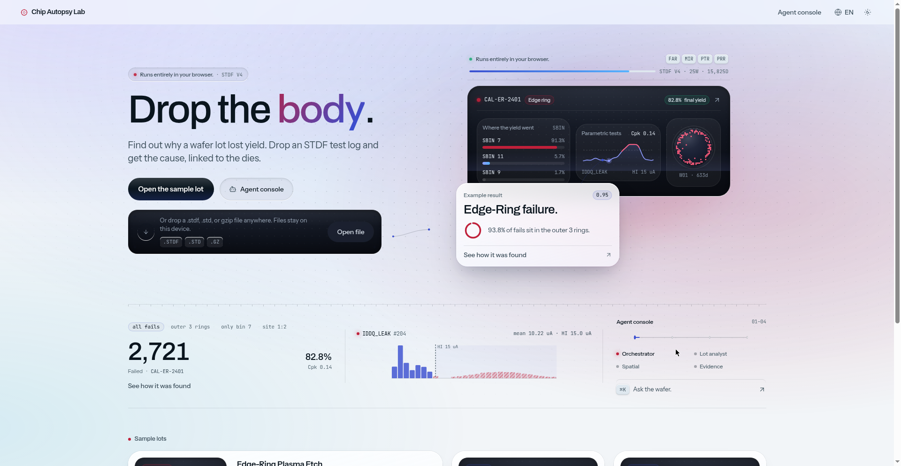
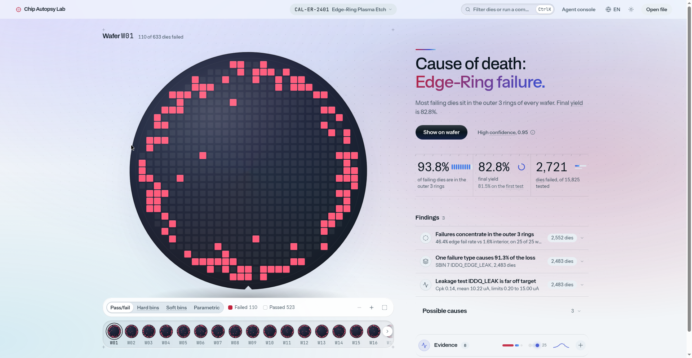
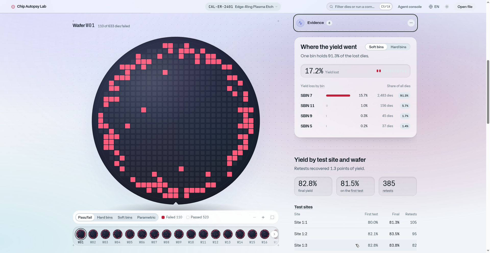
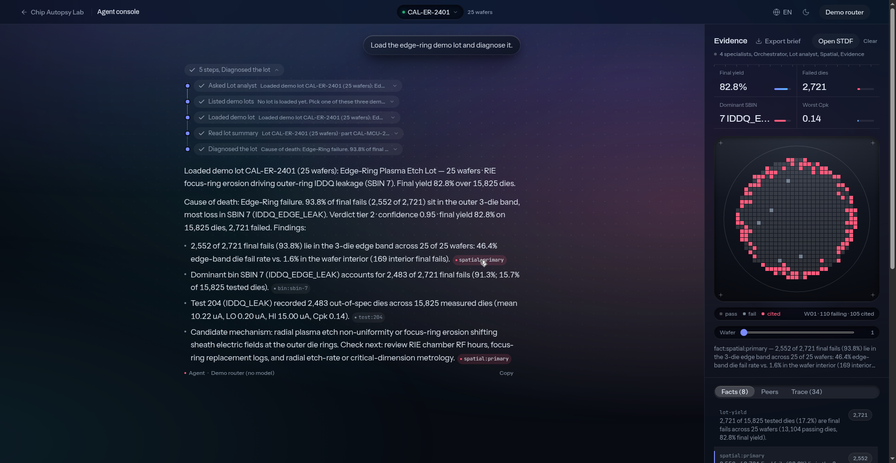

# Chip Autopsy Lab

Drop an STDF V4 wafer test log and get a one-sentence cause of death where every claim links to the dies, bins, and charts that prove it. Built for the Kiroween 2026 Frankenstein category, Chip Autopsy Lab stitches a decades-old ATE binary datalog format to a modern, local-first web analysis workbench.

## The problem

Test, product, and yield engineers at small fabless teams and OSATs routinely triage wafer sort excursions using heavy desktop tools or ad-hoc per-wafer Python, Excel, and matplotlib scripts. STDF V4 is a 1990s tag-length-value binary format with multi-site interleaving, optional trailing fields, and display-scaling flags that remains opaque without specialized parsers. Enterprise yield-management suites are cost-prohibitive for small teams, while open-source browser viewers stop at rendering disconnected charts without synthesizing a diagnosis. Chip Autopsy Lab turns raw binary logs into a verdict-first, evidence-linked failure analysis directly in the browser.

## What it does

- **Off-main-thread STDF V4 parsing**: Decodes 16 STDF V4 record types (`FAR`, `MIR`, `MRR`, `PCR`, `HBR`, `SBR`, `SDR`, `WIR`, `WRR`, `WCR`, `PIR`, `PRR`, `PTR`, `MPR`, `FTR`, `TSR`) inside a Comlink Web Worker, with native `DecompressionStream('gzip')` detected by `1F 8B` magic bytes, big- and little-endian byte order, multi-site `PIR`/`PRR` interleaving, truncated-stream recovery, and Bins-Only mode above 200 MB.
- **Interactive wafer maps**: Renders `Pass/Fail`, `Hard bins` (`HBIN`), `Soft bins` (`SBIN`), and `Parametric` modes on layered DPR-scaled Canvas2D surfaces with a non-occluding hover magnifier and readout, cursor-anchored wheel zoom, inertial drag pan, interactive bin-legend toggles, and `WCR` coordinate-axis (`POS_X`, `POS_Y`) and notch (`WF_FLAT`) orientation.
- **Stacked multi-wafer heatmap**: Aggregates per-`(X, Y)` failure rates across wafers on a perceptually uniform `magma` ramp with a numeric scale legend, cell hover readout, rectangular region selection, and animated wafer-gallery collapse.
- **Bin Pareto and yield summary**: Pairs a visx Bin Pareto chart (`SBIN`/`HBIN` toggle, dominant failure highlight, click-to-filter) with lot, wafer, and test-site yield breakdowns covering first-pass yield, final yield, retest counts, and single-site anomaly detection.
- **Parametric analysis**: Computes Welford mean and sigma, two-sided and single-sided `Cp`/`Cpk`, SI-prefixed scaled measurements, sortable test catalogs, histograms with `LO_LIMIT`/`HI_LIMIT` markers and scrub readout, and a parametric wafer heatmap mode.
- **WM-811K spatial signature classification**: Runs a deterministic, D4-symmetry-robust TypeScript classifier across all 9 WM-811K classes (`Center`, `Donut`, `Edge-Loc`, `Edge-Ring`, `Loc`, `Near-full`, `Random`, `Scratch`, `None`) with confidence scores and hedged root-cause hypotheses. Measured on real WM-811K wafers: 97.8% accuracy / macro-F1 0.885 on a held-out test split (see [Real-data accuracy](#real-data-accuracy-wm-811k)).
- **Verdict-first Autopsy Report with clickable evidence**: Evaluates a 6-tier deterministic verdict engine that leads with a plain-language cause of death and findings; clicking the verdict, summary stats, or any finding highlights the supporting dies on the wafer map and the matching bar in the Bin Pareto chart.
- **Live cross-chart brushing**: Brushing a region on the single-wafer map or stacked heatmap immediately cross-filters the Bin Pareto, yield summary, and parametric views, with removable filter chips and `Escape` or click-out clearing.
- **`Cmd-K` / `Ctrl-K` filter palette**: Opens an instant `cmdk` command palette backed by a typed Filter DSL and an offline natural-language grammar supporting queries such as `only bin 7`, `edge 3 rings`, `tests with Cpk < 1.33`, and `show edge failures with Cpk < 1.33`.
- **Optional LLM narrator with citation validation**: Routes optional prose rephrasing through a server-only `/api/autopsy/narrate` handler (`LLM_API_KEY`) that receives aggregate engine facts only, validates every cited fact ID and numeric claim on the client, and falls back deterministically to the offline template when unconfigured or if validation fails.
- **Internationalization, appearance, and accessibility**: Ships 5 UI languages (`English`, `简体中文`, `繁體中文`, `日本語`, `한국어`), System/Light/Dark themes with 4 accent colours (`Ember`, `Cobalt`, `Jade`, `Violet`), inline hover definitions for ATE terminology, WCAG 2.2 AA contrast, full keyboard navigation with screen-reader data tables and `aria-live` announcements, and complete `prefers-reduced-motion` support.
- **A forensic interface, not a dashboard**: a tilted 3D sample deck and live telemetry strip on the landing page, a verdict screen that puts the cause of death beside the wafer map, an Evidence shelf that opens into the Pareto, yield, wafer-gallery and parametric charts in place, view transitions between every screen, and tap, press and scroll motion on phones.

## Try it

Live demo: `https://chip-autopsy-lab.vercel.app`

Demo video: https://youtu.be/ynIbq1NvfpU

### Measured on a real log

Dropped the way a visitor would drop it, a real third-party STDF V4 log (`sr_a595.stdf`, not in this repo) opened with about 1.7 s from drop to verdict: 78.3% yield, `SBIN 4` (`DELAY`) as the bin that costs the most, and `Delay Line #07` the weakest test at `Cpk` 0.48. The author measured this on the deployed site; the log is someone else's data and is not redistributed here.

### Demo lots

Three seeded, deterministic synthetic STDF V4 demo lots are loadable in one click from the landing page (and downloadable as binary `.stdf` files to drag back into the viewport). Each lot contains 25 wafers x 633 dies (15,825 dies) serialized through the same STDF V4 writer and parsed through the same Web Worker pipeline as user-dropped files:

| Demo lot | Preset ID / Lot ID | Failure scenario |
|---|---|---|
| **Edge-Ring Plasma Etch** | `edge-ring-etch` / `CAL-ER-2401` | RIE focus-ring erosion driving outer 3-ring `IDDQ_LEAK` failures (`SBIN 7`, `Edge-Ring`). |
| **Robotic Handling Scratch** | `handling-scratch` / `CAL-SC-2402` | Transfer-blade chord across wafers `W05`–`W22` causing `VCCA_SHORT` (`SBIN 9`, `Scratch`). |
| **Site 2 Probe Contact** | `site2-probe-contact` / `CAL-S2-2403` | Oxidized `Head 1 / Site 2` probe needles causing `VDD_CONT_R` contact opens and retest recovery (`SBIN 5`, spatially `Random` with a Test Site `1:2` anomaly). |

All demo lots are 100% synthetic. No proprietary foundry, OSAT, or product data is included.

## The interface

The interface is Carbon, the third design pass: a forensic bench rather than a dashboard. The landing page sets the sample lot on a tilted 3D deck over a 12-column telemetry strip; opening a lot unboxes the cause of death next to the wafer map; the Evidence shelf opens into the Pareto, yield, wafer gallery and parametric charts in place, without leaving the screen. Every screen switch runs as a view transition, and on a phone the same surfaces answer to tap, press and scroll instead of hover.









Also in `docs/screenshots/`: the dark landing page (`02-home-carbon-dark.png`), the parametric histogram (`07-parametric-histogram.png`), the network page (`05-network-page.png`), and the verdict screen in dark mode (`08-verdict-wafer-dark.png`).

## Agent layer (Open Agentic Web)

Chip Autopsy Lab is also a conforming **open agentic website**: it publishes an agent network that a normal browser runs, and another agentic site can call.

| Artifact | URL | What it is |
|---|---|---|
| Agent console | `/agents` | The interface: ask the network about the lot you have open, watch the tool calls, approve anything that changes the page, see the dies a claim points at |
| Site manifest | `/agent-manifest.json` | The network entry (name, front agent, definition path), router metadata, peer policy, action list, link map |
| Resolved network | `/agents/chip_autopsy_lab.network.json` | Neuro SAN agent-network data model, fully resolved, loaded by the browser runtime |
| Authored source | `/agents/chip_autopsy_lab.network.hocon` | The same network as editable HOCON; `node tools/build-agent-network.mjs` regenerates and validates the JSON |
| Peer link map | `/links.json` | Publisher-owned symbolic peer bindings (`agent_atlas`) |
| Runtime | `/agent-runtime/agent-runtime.mjs` | A dependency-free ES module that implements the profile's browser execution, pluggable inference, site actions, consent and peer loading — any site can use it |
| Network page | `/chip_autopsy_lab` | The human face of the peer-network URL |

**The network.** Four agents over the deterministic engine: `autopsy_conductor` (front) routes to `lot_analyst` (yield, bins, parametric capability, test-site anomalies), `pattern_pathologist` (WM-811K shape, per-wafer outliers, die highlighting) and `evidence_auditor` (fact ids, die counts, report export). The graph is data, published in full: instructions, tool lists and JSON Schemas.

**What the agents can see.** Twelve registered site actions, all returning aggregate engine facts: `list_demo_lots`, `load_demo_lot`, `get_lot_summary`, `diagnose_lot`, `get_spatial_pattern`, `get_parametric_report`, `compare_test_sites`, `query_dies` (the project's Filter DSL), `list_evidence`, `get_evidence`, `highlight_dies`, `export_report`. Raw STDF bytes stay in the Web Worker, so the architectural rule survives intact: an agent cannot quote, dump or leak a byte of the uploaded file. Two actions change the page — loading a lot and highlighting dies — and the runtime stops for the visitor's confirmation with the exact arguments.

**Inference is the visitor's.** The site funds nothing. Add an OpenAI-compatible router, model and key in model settings (Otari, OpenAI, OpenRouter, a local Ollama endpoint, or anything else that speaks `/chat/completions`); the key lives in this origin's localStorage, travels only to that router, and never appears in the network, prompts, action arguments or the execution trace. With no key, the console runs the same published network on a **deterministic demo router**: no model, no invention — it walks the network's own routing table, delegates to the specialist, runs real site actions and assembles the answer from the tools' own summaries. The interface labels every such answer.

**Why this is not a chatbot wrapper.** Every number an agent says comes from an engine fact that the app itself renders, with a stable id and a set of dies behind it (`fact:spatial:primary`, `fact:bin:sbin-7`). `diagnose_lot` returns the verdict engine's own cause of death and citations, not a paraphrase. The Evidence stage lights up exactly the dies the agent cited, so a visitor can check the claim against the wafer map in one click.

**Interop, as implemented.** Manifest and definition are CORS-public. A peer is identified as `<site-base>/<network-name>`; the runtime fetches its manifest, matches the name exactly or fails closed, fetches the definition, and runs it in this tab on the visitor's router and this site's limits, after the visitor approves the origin. Private context never crosses an origin. The network may call [Agent Atlas](https://agent-atlas-phi.vercel.app/agent_atlas), a public conformance checker, through `links.json`; the contact needs approval and is recorded in the trace.

**Checked by a peer.** [Agent Atlas](https://agent-atlas-phi.vercel.app/agent_atlas), a public conformance checker run by another entrant, reads this site's published files and reports **0 MUST failures / 97–98 of 100** ("conformant with warnings"). The single warning is the honest one: the twelve site actions are registered by this page and need publisher code, which the profile itself places outside the portable minimum.

[](https://agent-atlas-phi.vercel.app/agent_atlas)

`docs/agentic-web-gap-analysis.md` records the profile requirements against what the project had before this layer existed.

## Run locally

Prerequisites: Node.js 22+ and `pnpm`.

```bash
pnpm install
pnpm dev
```

Open `http://localhost:3000`.

### Testing and production build

```bash
# Unit and fast-check property-based tests
pnpm test

# Production build (Playwright serves the built .next output)
pnpm build

# End-to-end Playwright suite (install Chromium once)
npx playwright install chromium
pnpm test:e2e

# Lint, typecheck, and client bundle secret scan
pnpm lint
pnpm typecheck
pnpm scan:secrets
```

### Optional environment variables

Every core capability, demo lot, offline report template, and `Cmd-K` query grammar works offline with no environment variables configured. To enable optional server-side LLM narration on `/api/autopsy/narrate`, set server-only variables in `.env.local`:

| Variable | Required | Default | Purpose |
|---|---|---|---|
| `LLM_API_KEY` | Optional | Unset (narrator disabled) | Server-only bearer key for upstream chat completions. Never use a `NEXT_PUBLIC_` prefix. |
| `LLM_PROVIDER_URL` | Optional | `https://api.openai.com/v1/chat/completions` | OpenAI-compatible chat completions endpoint. |
| `LLM_MODEL` | Optional | `gpt-4o-mini` | Model identifier sent to the narration endpoint. |
| `NEXT_PUBLIC_NARRATION_ENABLED` | Optional (test only) | Unset | Set to `1` or `true` in local tests to trigger client narration requests against a mocked `/api/autopsy/narrate` route without setting `LLM_API_KEY`. |

## Privacy

Chip Autopsy Lab is local-first by design:

- Gzip decompression, STDF V4 binary parsing, columnar modeling, statistical analytics, WM-811K classification, and Filter DSL evaluation execute entirely in the browser.
- Raw STDF bytes, per-die coordinates, and die IDs never leave the device.
- The agent layer cannot bypass that boundary: its twelve site actions read aggregate engine facts and derived results only, so no agent (local or peer) can receive raw file content. Model credentials are never sent to this site or to a peer agent site.
- When `LLM_API_KEY` is configured on the server, only sanitized aggregate `EngineFact` summaries are sent to `/api/autopsy/narrate`. When unconfigured, the client makes zero narration requests.
- Privacy and secret hygiene are enforced by automated gates:
  - **Offline gate** (`e2e/gates-t20.spec.ts`): blocks all non-app-origin network requests and asserts zero third-party requests and zero console errors across landing, demo analysis, and palette filtering.
  - **Request-body scan** (`e2e/gates-t20.spec.ts` and `src/core/report/llm-payload-privacy.prop.test.ts`): asserts no outbound request body contains STDF `FAR` headers, gzip magic bytes, die IDs, or per-die coordinate/measurement fields.
  - **Bundle secret scan** (`pnpm scan:secrets` via `tools/scan-bundle-secrets.mjs`) and an ESLint rule (`eslint.config.mjs`) blocking any `NEXT_PUBLIC_LLM_*` reference.

## Built with Kiro

Kiro's agent wrote the spec, the steering, the hooks and the task list, ran the tasks, and verified each one; the section below is the process story, with one requirement traced from spec to property test to hook.

- Kiro artifacts: [`.kiro/`](.kiro/) — specs, steering, hooks, skills, MCP settings
- Process story and ["Where Kiro surprised us"](docs/devpost-submission.md#how-kiro-was-used)
- [Self-review against the judging criteria](docs/judging-review.md)

## How Kiro was used

Kiro's agent ran the build loop from the IDE, and every step left a file in this repo.

1. **Spec.** The spec has 17 EARS requirements, a design with 14 correctness properties, and a task list where every task cites its requirement ids. Kiro sent the first requirements and design drafts to Gemini through the Carbon MCP tool (`logs/phase2.log`, commits `af42af8`, `9076b54`), then reviewed them itself: one pass made 48 edits to `requirements.md` (`logs/kiro-review-req.log`), and another wrote `tasks.md` (`logs/kiro-tasks.log`, commit `e8af9c1`).
2. **Steering.** Four always-included files hold the product scope, the locked stack and STDF V4 decoding rules, the repo layout, and the design tokens. A fifth, `submission.md`, loads only when submission copy is edited.
3. **Hooks.** Saving a file under `src/` runs lint and typecheck. Saving under `src/core/` runs that file's unit and property tests. Saving an i18n file checks key parity across all 5 locales. Editing a spec `design.md` reruns every property suite. One manual hook rebuilds the table below from `.kiro/`.
4. **Agent tasks.** Tasks ran one at a time. Each prompt is in `logs/prompt-*.txt`, each run log is in `logs/`, each result is in `logs/progress.md`. Of the 194 commits in `git log`, 63 subjects end in `(Kiro <model>)` and 48 carry `(Carbon)`, meaning Kiro handed that task to Gemini through the Carbon MCP server and checked the result.
5. **Verification.** A task is ticked only after lint, typecheck, `pnpm test`, and its Playwright spec pass. The suite is 555 Vitest tests in 92 files, 16 of them `fast-check` property suites, plus 54 Playwright spec files in `e2e/`.

One trace you can follow:

- **Requirement 1.5** (`requirements.md`): check that the first record is `FAR` with `STDF_VER = 4`, then read numbers big-endian when `FAR.CPU_TYPE = 1` and little-endian when it is `2`.
- **Task 2.2** (`tasks.md`) builds `src/core/stdf/stdf-parser.ts` and cites Requirement 1.5. Sub-task 2.4 adds the property test.
- **Property 1** (`design.md`, "Validates: Requirements 1.3, 1.5, ...") says any generated lot, written in either byte order, parses back to an equal lot model. `src/core/stdf/stdf-roundtrip.prop.test.ts` checks it with `fast-check`.
- **Hooks.** `core-unit-tests-on-save.kiro.hook` runs that suite whenever a file in `src/core/stdf/` is saved, and it is told never to weaken a design property to make a test pass. `spec-properties-on-design-edit.kiro.hook` runs it again whenever `design.md` changes.

### Kiro features in this repo

| Kiro feature | Where in repo | How it shaped the project |
|---|---|---|
| **Specs** | `.kiro/specs/chip-autopsy-lab/` (`requirements.md`, `design.md`, `tasks.md`, `redesign.md`, `premium.md`), `.kiro/specs/judging-polish/` | 17 EARS requirements, 14 correctness properties, and a task list where each task cites its requirements. The visual and interaction rules in `redesign.md` and `premium.md` governed every module and acceptance gate; the polish spec covers the submission round itself. |
| **Steering, always included** | `.kiro/steering/` (`product.md`, `tech.md`, `structure.md`, `design-language.md`) | Product scope, STDF V4 binary decoding rules, framework-free core isolation, design tokens, copy restraint, and repository conventions across sessions. |
| **Steering, file match** | `.kiro/steering/submission.md` | Rules for submission copy: traceable facts, the Vercel URL as the only demo link, all five judging criteria. Loads for `docs/**/*.md` and `README.md` only. |
| **Hooks** | `.kiro/hooks/` (5 hooks) | Lint and typecheck on every `src/` save, unit and property tests on every `src/core/` save, i18n key parity across 5 locales, every property suite on a `design.md` edit, and one manual hook that rebuilds the usage table. Details below. |
| **Agent skills** | `.kiro/skills/` (14 skills) | `accessibility`, `animation-performance`, `apple-design`, `claude-api`, `doc-coauthoring`, `frontend-design`, `make-interfaces-feel-better`, `prompt-optimizer`, `react-best-practices`, `receiving-code-review`, `systematic-debugging`, `test-driven-development`, `verification-before-completion`, `webapp-testing` — WCAG 2.2 AA, composite-only 60 fps motion, tactile surface craft, test-first work, debugging and Playwright audits. |
| **Property-based tests** | 16 `*.prop.test.ts` suites across `src/core/` and `src/ui/` | 14 suites map the 14 design properties (`Property 1`–`Property 14`: STDF round-trip, parser bounds and truncation safety, retest determinism, yield additivity, Pareto conservation, stacked heatmap conservation, `Cp`/`Cpk` invariants, WM-811K D4 robustness, demo determinism, report claim integrity, citation validator soundness, selection filter algebra, Filter DSL codec round-trip, outbound LLM payload privacy); 2 UI suites cover palette and sheen math. |
| **MCP** | `.kiro/settings/mcp.json`, `tools/carbon-mcp/carbon_mcp.py` | A local stdio server with `carbon_task` and `carbon_ask`, so Kiro could hand a drafting or review turn to another model and read the result back, with phase logs kept in `logs/`. |

### Where Kiro surprised us

- **It found that our spec broke its own rules.** Reviewing `requirements.md`, Kiro reported: "the spec said it must be a single sentence, but its own example is two sentences." In the same pass it caught a privacy leak in the design: "the URL stored the Wafer ID, a string from the STDF file, which the privacy rule forbids. It now stores a wafer index." (`logs/kiro-review-req.log`)
- **It explained why our fixes seemed to change nothing.** During redesign task R8, Kiro found: "Playwright serves the existing production build from `.next` and rebuilds only if that build is missing. Until you run `pnpm build`, `pnpm e2e` tests old code." It then traced the remaining slow frame to the wafer-strip ArrowRight handler: "It spends 31 ms in script and 8 ms forcing a layout". (`logs/redesign-R8-kiro.log`)
- **It told us what it had not checked.** After writing the first three hooks, Kiro said: "I haven't watched them fire in Kiro, and I wrote the hook format from memory without checking it against the Kiro docs." It also noted that the parity test covered `ja` and `ko` while the hook named only the two Chinese tables. This round fixed that hook. (`logs/t22-hooks.log`)

### Other agents

The interface is the part that used other models, and the commit subjects say which. The Carbon redesign and its three-step v3 pass carry `(agy Gemini 4 Carbon)` (`59a879e`, `da64e4c`, `c9b4866`, `a82dce9`, `fafff5b`, `d9fce1f`), and Kiro reviewed that work in `0f5bf0a` (`Kiro claude-opus-5.5`). The view transitions (`0bf931e`) and the touch and scroll motion (`87bf4d4`) are Kiro's own, written with `claude-opus-5.5`. Earlier, Gemini took drafting turns through the Carbon MCP server (48 `(Carbon)` commits), the Antigravity CLI wrote tasks 12 and 13 (`logs/progress.md`), and Opus 4.6 did a second design review (`a96ab93`). The specs, the steering, the hooks, the task list and the verification of every task ran in Kiro.

### Hooks

Agent hooks in `.kiro/hooks/` run on file save, or on demand for the last one:

| Hook file | Trigger | What the agent does |
|---|---|---|
| `lint-typecheck-on-save.kiro.hook` | `src/**/*.ts`, `src/**/*.tsx` | Runs ESLint on the saved file and `pnpm typecheck`, then fixes errors the change introduced. |
| `core-unit-tests-on-save.kiro.hook` | `src/core/**/*.ts` | Runs the colocated `*.test.ts` and `*.prop.test.ts` suites and fixes the source or updates the tests. |
| `i18n-key-parity-on-save.kiro.hook` | `src/core/i18n/**`, `src/ui/i18n/**` | Runs `src/core/i18n/i18n.test.ts` and checks that `en`, `zh-CN`, `zh-TW`, `ja`, and `ko` have matching keys and placeholders. |
| `spec-properties-on-design-edit.kiro.hook` | `.kiro/specs/**/design.md` | Runs all 16 `*.prop.test.ts` suites and reports any design property without a matching test. |
| `kiro-usage-table-refresh.kiro.hook` | Manual (user-triggered) | Recounts `.kiro/` artifacts and tests and rewrites the usage tables in this README and `docs/devpost-submission.md`. |

## Real-data accuracy (WM-811K)

Measured on the real, expert-labeled **WM-811K** wafer maps (Wu, Jang & Chen, "Wafer Map Failure Pattern Recognition and Similarity Ranking for Large-Scale Data Sets", *IEEE Trans. Semiconductor Manufacturing* 28(1):1–12, 2015, doi:10.1109/TSM.2014.2364237), downloaded from the public mirror https://huggingface.co/datasets/lslattery/wafer-defect-detection. All 172,950 labeled wafers, fixed stratified 70/30 split (seed 20261120). Everything that was tuned or learned used the **train ids only**; the **test** split (51,886 wafers) was run once after freezing.

| Classifier | Test accuracy | Test macro-F1 | `None` wafers called a defect |
|---|---:|---:|---:|
| Original rules only (baseline) | 51.3% | 0.289 | 44.5% |
| **Current: rules + handcrafted features + small logistic regression** | **97.8%** | **0.885** | **0.5%** |

Test recall per class: Center 0.92 · Donut 0.91 · Edge-Loc 0.82 · Edge-Ring 0.98 · Loc 0.70 · Near-full 0.98 · Random 0.88 · Scratch 0.66 · None 0.995. (Train split, in-sample: 98.0% / macro-F1 0.898.) About 0.35 ms per wafer in Node, single thread.

How it works: features are computed on the raw map and on 3×3-neighbour-denoised maps (zone/ring densities relative to each wafer's own background, geometry of the largest denoised region, clustering), as in feature-based WM-811K work; a multinomial logistic regression (87 features, ~970 plain TypeScript constants in `src/core/patterns/wm811k-model.ts`) makes the call; decisive rule scores still win for clean, STDF-style wafers. Sources and design notes: `logs/wm811k-tuning-notes.md`. Full tables and confusion matrices: `logs/wm811k-benchmark.md` / `.json`.

Limitations:
- Faint Loc, Edge-Loc and Scratch patterns are still the main misses (most go to `None`); Loc ↔ Edge-Loc is the main confusion.
- The learned part follows WM-811K's labels (one fab, labels known to be somewhat noisy): a uniform ~10% scatter counts as `None`. Confidence is a WM-811K class probability, not calibrated for other fabs' STDF data.
- Not directly comparable to published numbers that use other splits (e.g. Wu et al.'s own partition) or balanced subsets; accuracy here is dominated by `None` (85% of wafers), so read macro-F1 and per-class recall.

Reproduce (the dataset is not stored in this repo):

```bash
curl -L -o /path/to/wm811k/LSWMD.pkl https://huggingface.co/datasets/lslattery/wafer-defect-detection/resolve/main/LSWMD.pkl
(cd /path/to/wm811k && python3 /path/to/repo/tools/wm811k-export.py)   # -> labeled.jsonl, split.json (needs pandas)
npx tsx tools/bench-wm811k.ts /path/to/wm811k                     # benchmark
npx tsx tools/wm811k-export-features.ts /path/to/wm811k feats.csv  # optional: re-train (needs scikit-learn)
python3 tools/train-wm811k.py feats.csv                            # uses split == train rows only
```

## Architecture

```text
src/
├── core/               # Pure, framework-free TypeScript (ESLint-enforced: zero React/Next/DOM imports or globals)
│   ├── stdf/           # STDF V4 binary cursor, parser, writer, gzip ceiling stream
│   ├── model/          # Columnar LotModel, PRR retest resolution, edge-ring BFS
│   ├── analytics/      # Yield summary, site anomaly z-test, Bin Pareto, stacked heatmap, Cp/Cpk stats
│   ├── patterns/       # 9-class WM-811K D4-invariant classifier and hedged root-cause hypotheses
│   ├── report/         # Engine facts, 6-tier verdict precedence, localized template report, citation validator
│   ├── query/          # Filter DSL codec, offline NL grammar, selection predicates
│   ├── demo/           # Seeded Mulberry32 PRNG and deterministic synthetic STDF V4 lot generator
│   └── i18n/           # 5-locale dictionaries, Intl formatters, glossary entries
├── workers/            # Comlink Web Worker (autopsy.worker.ts) and typed client bridge (worker-client.ts)
├── ui/                 # Client components: layered Canvas2D wafer stage, visx charts, report, cmdk, theme, motion
│   ├── wafer-map/      # Base/Fail/Overlay canvases, camera physics, magnifier, stacked heatmap, wafer strip
│   ├── charts/         # BinParetoChart, YieldSummaryPanel, ParametricPanel, ParametricHistogram
│   ├── report/         # VerdictHero, ConfidencePill, StatRow, FindingsList, narration hook
│   ├── command-palette/# Cmd-K / Ctrl-K CommandPalette
│   ├── state/          # Central Zustand SelectionStore and ThemeStore
│   ├── theme/          # System/Light/Dark + accent colour controllers and pre-hydration scripts
│   ├── tokens/         # Light/Dark/Wafer colour tokens, typography, motion springs, WCAG contrast helpers
│   ├── motion/         # Reveal choreography and reduced-motion hooks
│   ├── i18n/           # I18nProvider, useT, Untranslated (<bdi translate="no">)
│   ├── primitives/     # Button, SegmentedControl, DropdownMenu, ModalSheet, Term, Tooltip, CountUp, Disclosure
│   └── layout/         # AppShell, NavBar, LotPicker, EmptyStateCard, FullWindowDropZone, LoadedLotOverview
└── app/                # Next.js App Router entry, self-hosted fonts, server-only /api/autopsy/narrate route handler
```

**Data flow**: Dropping a `.stdf`, `.std`, or `.gz` file (or selecting a demo preset, which synthesizes raw STDF bytes via `stdf-writer.ts`) transfers an `ArrayBuffer` zero-copy through `worker-client.ts` to `autopsy.worker.ts` via Comlink. Inside the worker, optional gzip decompression (`1F 8B` magic bytes), STDF V4 record framing, columnar `LotModel` construction, yield/site analytics, WM-811K classification, and deterministic `AutopsyReport` generation run off the main thread while streaming progress updates. The UI loads the resulting lot into the central Zustand `SelectionStore`, so clicking any report claim, brushing the wafer map or stacked heatmap, clicking a Pareto bar or site row, or running a `Cmd-K` Filter DSL query recomputes derived `Uint8Array` die masks across every linked view without reparsing the file. If `LLM_API_KEY` is configured on the server, `/api/autopsy/narrate` optionally rephrases aggregate engine facts and the client validates every citation before display.

## Tech stack

- **Language**: TypeScript 5.9 (`strict` mode)
- **Framework**: Next.js 16 (App Router) and React 19
- **Styling and typography**: Tailwind CSS v4 with `@theme` CSS variables and self-hosted Instrument Sans, Archivo, and JetBrains Mono fonts
- **Wafer rendering**: Custom layered HTML5 Canvas2D renderer with DPR scaling and CSS-transform camera physics
- **Charts**: visx (`@visx/scale`, `@visx/shape`)
- **State and worker**: Zustand and Comlink over a module Web Worker with native `DecompressionStream('gzip')`
- **Interaction and motion**: `cmdk`, Motion (`motion/react`), Sonner, and `lucide-react`
- **Testing**: Vitest, `fast-check` (property-based testing), and Playwright (end-to-end and visual/perf/privacy gates)

## Third-party code and data

### Dependencies (`package.json`)

| Package | Role | License |
|---|---|---|
| `next`, `react`, `react-dom` | App Router framework and UI runtime | MIT |
| `zustand` | Central selection and theme state | MIT |
| `comlink` | Typed Web Worker RPC bridge | Apache-2.0 |
| `@visx/scale`, `@visx/shape` | Bin Pareto and parametric histogram primitives | MIT |
| `cmdk` | `Cmd-K` / `Ctrl-K` command palette | MIT |
| `motion` | Spring and layout animations with reduced-motion support | MIT |
| `sonner` | Accessible toast queue | MIT |
| `lucide-react` | Interface icons | ISC |
| `clsx`, `tailwind-merge` | Conditional class composition | MIT |
| `@fontsource/instrument-serif`, `@fontsource/jetbrains-mono`, `@fontsource-variable/inter` | Self-hosted fonts (plus `src/app/fonts/InterVariable*.woff2`) | OFL-1.1 |
| `geist` | Font package (devDependency) | SIL Open Font License 1.1 |
| `tailwindcss`, `@tailwindcss/postcss`, `postcss` | CSS compilation | MIT |
| `typescript` | Type checker and compiler | Apache-2.0 |
| `vitest`, `fast-check` | Unit and property-based test runner | MIT |
| `@playwright/test` | End-to-end browser verification | Apache-2.0 |
| `eslint`, `@eslint/js`, `@next/eslint-plugin-next`, `typescript-eslint`, `globals`, `@types/*` | Linting and type definitions | MIT |

### Agent skills (`.kiro/skills/`)

| Skill | Source / Copyright | License |
|---|---|---|
| `accessibility` | Addy Osmani | MIT |
| `animation-performance`, `apple-design` | Emil Kowalski | MIT |
| `make-interfaces-feel-better` | Jakub Krehel | MIT |
| `react-best-practices` | Vercel, Inc. | MIT |
| `receiving-code-review`, `systematic-debugging`, `test-driven-development`, `verification-before-completion` | Jesse Vincent | MIT |
| `claude-api`, `webapp-testing` | Anthropic, PBC | Apache-2.0 |
| `frontend-design` | Included `LICENSE.txt` | Apache-2.0 |
| `doc-coauthoring`, `prompt-optimizer` | Functional Software, Inc. dba Sentry | Apache-2.0 |

### External data

No external dataset is bundled in this repository, and all demo lots and test fixtures are synthesized locally. The WM-811K dataset (Wu, Jang & Chen 2015; MIR Lab, mirrored at https://huggingface.co/datasets/lslattery/wafer-defect-detection) defines the 9 spatial defect classes and was used offline to fit and benchmark the classifier: the only thing derived from it in the repo is `src/core/patterns/wm811k-model.ts`, about 970 logistic-regression constants (no wafer maps). The mirror states no license; check the original MIR Lab / Kaggle terms before redistributing.

## License

MIT. See [`LICENSE`](LICENSE).
